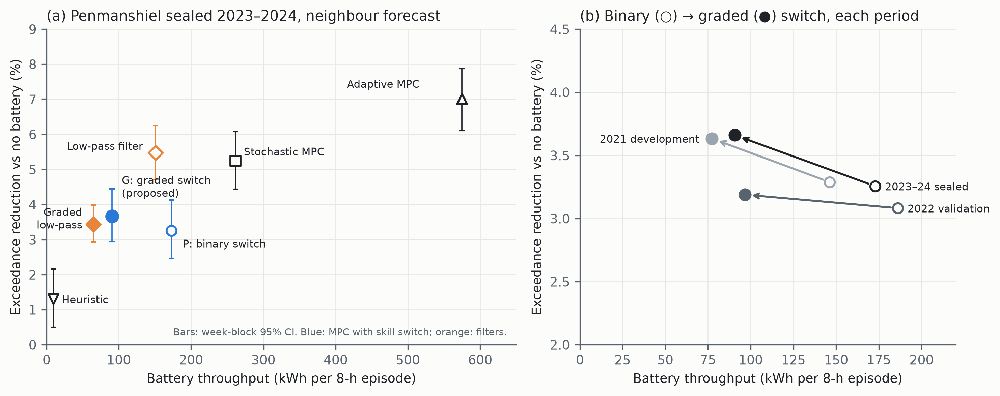
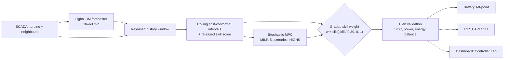

# WindGrid: skill-aware battery control of wind-power ramps

[](https://github.com/arqam3025/wind-energy-ai-optimisation/actions/workflows/ci.yml)

[](LICENSE)
[](https://github.com/astral-sh/ruff)


**Raja Arqam Abdullah · MSc Artificial Intelligence · Teesside University**

Wind farms must keep their power ramps within grid limits. A battery can smooth those ramps, but
only if the controller acts on forecasts that are actually good enough, and every unnecessary cycle
wears the battery. WindGrid is a forecast-aware battery dispatch system that:

- forecasts 10–60 minutes ahead (LightGBM with neighbour-turbine features) with **conformal
  uncertainty intervals**;
- plans the battery with a **scenario-based stochastic MPC**, solved exactly as a mixed-integer
  linear program;
- applies a **graded forecast-skill guardrail** that scales the plan by recently verified forecast
  skill, so the battery stays idle when the forecast is no better than persistence;
- ships as a tested **Python package, REST API, CLI, Docker images and dashboard**.

**Live demo:** _add the Streamlit Community Cloud link here after deployment (see [Deployment](#deployment))_

## Results

Three pre-registered studies. Each protocol was frozen and its SHA-256 recorded before its test
data was opened, and each test ran once from a clean checkout.

| Study | Test data | Outcome |
|---|---|---|
| Simulation | 18,900 held-out episodes | 13/13 hypotheses supported; 87–99% less ramp exceedance with skilful forecasts |
| Kelmarsh wind farm | sealed 2023–2024, 2,048 episodes | 4/4 supported; −3.2% exceedance, 73% less battery use than adaptive MPC |
| Penmanshiel wind farm (no re-tuning) | sealed 2023–2024, 2,067 episodes | 6/6 supported; graded guardrail: same reduction as the binary switch with **47% less battery throughput** |



Honest reading: with real SCADA-only forecasts (skill ≈ 0.15) the reductions are small, and
adaptive MPC or a forecast-driven low-pass filter reduce more at a higher battery cost. With a
perfect forecast the same controller removes more than 99% of exceedance, so better ramp forecasts
are the main route to larger gains. Details: [manuscript](docs/MANUSCRIPT.md).

## Quick start

**Everything with Docker** (API on :8000, dashboard on :8501):

```bash
docker compose up --build
```

**Or with Python 3.12:**

```bash
pip install -e ".[all]"
windgrid simulate     # compare all controllers, closed loop, on the bundled real-data sample
windgrid serve        # REST API: http://127.0.0.1:8000/docs
windgrid dashboard    # dashboard: http://127.0.0.1:8501
windgrid check        # lint + every data-free test suite, exactly as CI runs them
```

## REST API

| Method | Path | Purpose |
|---|---|---|
| `GET` | `/health` | liveness and version |
| `GET` | `/v1/controllers` | available controllers and battery configuration |
| `POST` | `/v1/dispatch` | one battery decision from a window of released history |
| `GET` | `/v1/sample` | a ready-made valid request from the bundled sample |
| `POST` | `/v1/simulate` | closed-loop replay of one 8-hour episode |

```bash
curl -s http://127.0.0.1:8000/v1/sample > request.json
curl -s -X POST http://127.0.0.1:8000/v1/dispatch -H "Content-Type: application/json" -d @request.json
```

```json
{"controller": "graded_mpc", "status": "skill_scaled", "skill_score": 0.137, "skill_weight": 0.458,
 "charge_kw": 0.0, "discharge_kw": 0.0, "forecast_available": true, "fallback": false, "computation_ms": 11.8, "…": "…"}
```

Production behaviour:
- **Fail-closed:** gaps, missing forecasts or too little history mean the battery stays idle, and
  the reason is returned.
- **Strict validation:** timezone-aware, contiguous 10-minute grid; unknown fields are rejected
  (HTTP 422 or 400).
- **Plan check:** every plan is validated against the battery model before it is returned.
- **Observability:** every response carries `X-Request-ID` and `X-Process-Time-ms`, and every
  request is logged as one JSON line.
- **Same code as the research:** the API calls the exact controller functions used in the
  pre-registered studies. A test proves that a replay through the API reproduces the research
  closed loop bit for bit.

## Architecture



## Engineering

| Practice | Where |
|---|---|
| Continuous integration on Ubuntu and Windows: lint, 300+ tests, CLI smoke test, Docker build, container smoke test | [`.github/workflows/ci.yml`](.github/workflows/ci.yml) |
| Container images published to GitHub Container Registry on every push to `main` and every release | `ghcr.io/arqam3025/windgrid-api`, `windgrid-dashboard` |
| Packaging with pinned dependencies and optional extras (`api`, `dashboard`, `dev`) | [`pyproject.toml`](pyproject.toml) |
| Linting and formatting (ruff), pre-commit hooks, Dependabot updates | [`.pre-commit-config.yaml`](.pre-commit-config.yaml), [`.github/dependabot.yml`](.github/dependabot.yml) |
| Causality and leakage tests, physical-invariant checks (SOC, power, energy conservation) | `publication_v2/*/tests` |
| Frozen protocols, checksummed results, logged deviations | `docs/STAGE*_CONFIRMATORY_PROTOCOL.md` |

## Deployment

- **Docker:** `docker compose up --build`, or pull the published images from GHCR.
- **Streamlit Community Cloud (free):** new app → this repository, branch `main`, main file
  `app/dashboard.py`, Python 3.12. `app/requirements.txt` and `packages.txt` are already set up.
  Without the private study data, the app opens on the Controller Lab, which runs on the bundled
  sample.

## Repository map

| Path | Content |
|---|---|
| `windgrid/` | Production package: dispatch service, REST API, CLI, closed-loop simulator, demo sample |
| `publication_v2/stage2/` | Forecasting contract (14 causal features, six horizons) and conformal intervals |
| `publication_v2/stage31/`–`stage33/` | Battery MILP, synthetic wind, stochastic MPC, skill switch, simulation study |
| `publication_v2/stage4/`, `stage5/` | Kelmarsh and Penmanshiel real-data pipelines, graded switch, low-pass baseline, frozen runners |
| `app/` | WindGrid AI dashboard (Streamlit): Controller Lab, real-data validation, research pages |
| `docs/` | Manuscript, protocols, results, figures, data admission records |
| `src/windresearch/`, `scripts/`, `audits/` | Earlier retrospective XGBoost study, preserved ([history](docs/legacy/README_windgrid_dashboard_phase.md)) |

**Research documents:** [manuscript](docs/MANUSCRIPT.md) · [how to run every stage](docs/HOW_TO_RUN.md) ·
results ([simulation](docs/STAGE33_CONFIRMATORY_RESULTS.md), [Kelmarsh](docs/STAGE4_REAL_DATA_RESULTS.md),
[Penmanshiel](docs/STAGE5_SECOND_SITE_RESULTS.md)) · protocols ([simulation](docs/STAGE33_CONFIRMATORY_PROTOCOL.md),
[Kelmarsh](docs/STAGE4_CONFIRMATORY_PROTOCOL.md), [Penmanshiel](docs/STAGE5_CONFIRMATORY_PROTOCOL.md)) ·
[research branch history](docs/legacy/README_research_branch.md)

## Licence, data and citation

- **Code:** [MIT](LICENSE).
- **Data:** Kelmarsh (DOI 10.5281/zenodo.16807551) and Penmanshiel (DOI 10.5281/zenodo.16807304)
  SCADA data are CC-BY-4.0. The raw data is not redistributed, apart from the small attributed demo
  sample in `windgrid/data/`.
- **Citation:** see [CITATION.cff](CITATION.cff). The manuscript is an unpublished MSc working draft.
