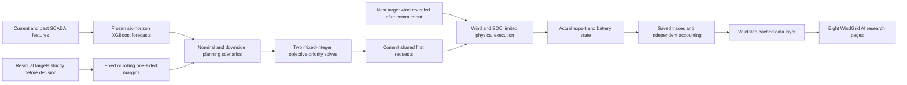

# WindGrid AI — Wind–Battery Digital Twin

**Raja Arqam Abdullah · MSc Artificial Intelligence · Teesside University**

A modular Streamlit research platform for the `wind-energy-ai-optimisation` study: XGBoost wind forecasts at 10–60 minutes, causal one-sided uncertainty and two-stage mixed-integer MPC. The dark industrial interface uses interactive Plotly charts and a shared historical replay cursor. It is not a live wind-farm controller.

## Eight-page research platform

| Page | Working features | Required artifacts |
| --- | --- | --- |
| Command Center | Recorded turbine/battery/grid power flow, replay-state KPIs, episode profile and event timeline with jump-to-event | Local evaluation input and paired traces; aggregate fallback otherwise |
| Digital Twin | Play/pause/back/step/reset, adjustable viewing speed, 10-minute cursor, SOC, flows and prefix energy balance; stops at episode end | Local evaluation input and paired traces |
| AI Forecasting Lab | All six horizons, XGBoost/actual/persistence comparisons, one-sided lower bounds, MAE/RMSE and empirical coverage | Summaries for aggregate charts; traces/input and fixed calibration for decision-level bounds |
| MPC Decision Explorer | Six-step scenario **inputs**, logged first requests versus realised execution, constraints and three-case comparison | Local input/traces; fixed calibration for fixed scenario paths |
| Battery Analytics | SOC distribution, throughput/losses, AC equivalent-full-cycle proxy, inventory, conservation waterfall and actual versus adjusted export | Summaries for aggregate views; interval traces for detailed accounting |
| Grid Stability Lab | All three cases, signed/absolute ramps, introduced/removed violations, event filters and improvement/worsening attribution | Summaries for aggregate views; interval traces for event analysis |
| Research Results | Original 49-block tables, paired Plotly comparisons, coverage, statistical caveats and CSV downloads | `docs/tables_v2/` |
| Reproducibility | Current freeze/59-reference verification, installed environment, prior/current validation records, document downloads and commands | Local manifest/referenced files for integrity; missing artifacts are reported |

Uncontrolled wind is calculated directly from observed generation with zero battery flows; its nonexistent SOC is **N/A**. The AC equivalent-full-cycle proxy is throughput divided by twice the 2,000 kWh capacity, not measured degradation or remaining life. Full six-step planned charge/discharge/SOC trajectories, stage objective values, MIP gaps and solve times were not logged and are explicitly unavailable; WindGrid never invents them.

See the [platform guide and verification record](docs/windgrid_platform_guide.md) for navigation, controls, validation, missing-data behaviour and test limitations. Playback changes only the viewing cursor: it does not optimise again, tune parameters or modify the frozen study. Additional simulations remain separate commands with unique output names.

## What the research demonstrates

On 49 paired daily episodes (7,056 ten-minute transitions per controller), adaptive one-sided MPC uses **27.86% less battery throughput**, incurs **27.92% less modelled conversion loss**, and has **0.77% less summed ramp exceedance and 16 fewer violations** than frozen fixed-margin MPC. The development preference remains unchanged.

**Both MPC controllers worsen aggregate ramp exceedance, violation count and mean absolute ramp versus uncontrolled wind, although they reduce the maximum ramp.** This negative result is part of the research, not an implementation defect inferred from outcome alone.

| Strategy | Violations | Exceedance sum (kW) | Battery throughput (MWh AC) | Conversion loss (MWh) |
| --- | ---: | ---: | ---: | ---: |
| Uncontrolled wind | 1,465 | 317,210.288 | 0 | 0 |
| Fixed-margin MPC | 1,502 | 326,158.296 | 35.486898 | 1.821593 |
| Adaptive one-sided MPC | 1,486 | 323,638.526 | 25.598677 | 1.312916 |

Adaptive actual export is 0.987701 MWh lower than fixed; hypothetical terminal-SOC-adjusted export is 0.551229 MWh higher. Inventory adjustment is not additional realised export or a feasible restoration dispatch. XGBoost has lower RMSE but higher MAE than persistence at every horizon. Lower throughput does not establish longer battery lifetime.

The comparison is **retrospective**, not an untouched confirmatory test. Evaluation-period investigations predate the freeze. Development block 6 is excluded, but five of its six-horizon target timestamps overlap block 7 (15 forecast-target pairs and five scored h1 outcomes). Original scores are preserved and this issue is disclosed.

## Research package

- [Supervisor-review manuscript](docs/paper_submission_draft.md), including the complete mathematical appendix and actual figures/tables.
- [Grid-ramp diagnostic](docs/grid_ramp_diagnostic.md): exact injection identities, introduced/removed violations, forecast/scenario mismatch and representative event windows.
- [15-paper literature review](docs/literature_review.md), with primary sources, DOIs and bounded novelty claims.
- [Full mathematical formulation](docs/mathematical_formulation.md) and [methodology](docs/methodology.md).
- [Reproduction guide](docs/reproducibility.md), [verification report](docs/final_verification_report.md) and [unresolved scientific issues](docs/unresolved_scientific_issues.md).
- [Original v2 results](docs/heldout_results_v2.md) and [earlier paper draft](docs/paper_draft.md), preserved as historical artifacts.

## Architecture



The primary allowance is 100 kW on the weighted six-step exceedance sum. It is substantive lexicographic tolerance. The battery is 2,000 kWh / 1,000 kW, SOC 40–90%, initial SOC 50% per episode, and efficiency 95% each way. Charging is wind-only. The 1,000 kWh reserve is a soft objective target; the hard minimum is 800 kWh.

## Windows setup

Use Python 3.12. The existing working `.venv` is already tested. For a separate environment:

```powershell
py -3.12 -m venv .venv_review
.venv_review/Scripts/python.exe -m pip install -r requirements-research.txt -c docs/environment-frozen-evaluation.txt
```

The direct research/dashboard requirements and preserved transitive snapshot specify the tested package versions. A fresh network installation was not certified in this task. For saved-summary exploration only, `requirements-dashboard.txt` is the smaller dependency set. The historical `requirements.txt` is preserved and omits CVXPY/HiGHS.

## Launch the local dashboard

From the repository root:

```powershell
.venv/Scripts/python.exe -m streamlit run app/dashboard.py --server.address 127.0.0.1 --server.port 8501 --browser.gatherUsageStats false
```

Open **http://127.0.0.1:8501**. Substitute `.venv_review/Scripts/python.exe` if using the new environment. Use the sidebar's Operations, Analysis and Evidence navigation. Controller, block, forecast horizon and recorded-interval controls are shared across pages. Digital Twin playback advances one recorded ten-minute interval at the selected viewing speed and pauses at the final sample; it never jumps across an episode or missing-data gap. The server must remain running while the browser is open.

With local interval data missing, `docs/tables_v2/` supports aggregate-only exploration with an explicit warning. Missing or malformed artifacts are rejected; no demonstration measurements are substituted. CSV caching includes the resolved path, file size and modification time. Full local calibration/development/input artifacts and CVXPY/HiGHS are required for separately invoked solver replays. The new platform does not embed a parameter-tuning or exploratory simulation engine. The smaller `requirements-dashboard.txt` includes Streamlit, Pandas, NumPy and Plotly; no new browser or animation package is required.

## Verification and analysis commands

```powershell
.venv/Scripts/python.exe -B -m unittest discover -s tests -v
.venv/Scripts/python.exe -B scripts/verify_research_completion.py
```

For an additional frozen replay, choose a new run name:

```powershell
.venv/Scripts/python.exe scripts/run_frozen_heldout.py --run my_unique_replay --blocks 1
```

Omit `--blocks 1` for the unchanged full 49-block scope; then analyse it with:

```powershell
.venv/Scripts/python.exe scripts/analyse_frozen_heldout.py --run my_unique_replay
```

A one-block run is not a new full evaluation. The original runner skips any existing CSV without authenticating completeness; independently verify resumed outputs and do not use Python `-O`. Historical preparation/training scripts are unnecessary for replay and some overwrite outputs.

Additional diagnostics are produced by `scripts/build_completion_diagnostics.py`. Its current report/tables/figures already exist and exclusive creation prevents overwriting. Reproduce in a separate checkout where those new generated outputs are absent, with the original local inputs supplied. The [guide](docs/reproducibility.md) explains artifact requirements and versioning.

## Data, integrity and public-release limits

Source: [Wind Turbine SCADA Dataset, Berker Isen](https://www.kaggle.com/datasets/berkerisen/wind-turbine-scada-dataset), local file `data/raw/T1.csv`. The exact downloaded version, timezone, measurement aggregation and redistribution terms require author verification. Raw data, models, full traces, fine-grained diagnostic interval/event CSVs and audit solver replays are ignored by Git; a clone alone cannot reproduce the full simulation. Summary tables and figures are included in the research package, subject to release review. Local diagnostic exports still exist for analysis; do not force-add them before rights review.

The frozen manifest remains `results/development_controller_freeze_manifest.json`:

```text
b007aa5c57b5610ea75663d592b92816598c15658ed21bf0fcd99c107859895a
```

All frozen controllers, models, data, calibration and original results remain unchanged. Four explicitly authorised documentation/config files were archived before this completion update. No retraining, held-out tuning, scored-set change, Git push or external publication occurred.

There is no selected project licence or cleared public data archive. Before publication, curate the intended commit/tag and artifact access, review rights and bibliography, and obtain author/supervisor approval. Credential-pattern checks found no matches but do not guarantee secret-free history. Do not mirror internal refs or blindly force-add ignored artifacts.

## Research-grade audit and experiments

The [prioritised audit](docs/RESEARCH_AUDIT.md) and [new experimental results](docs/EXPERIMENTAL_RESULTS.md) document causal checks, forecast baselines, coverage failures during rapid changes, six comparable controllers, development-only sensitivities/ablations and dependence-aware paired intervals. See [limitations](docs/RESEARCH_LIMITATIONS.md), [publication assessment](docs/PUBLICATION_READINESS.md) and the [complete reproduction commands](docs/RESEARCH_GRADE_REPRODUCIBILITY.md).

New code is in `src/windresearch/`; experiment plans are in `configs/research_audit_v1.json` and `configs/mpc_research_v1.json`. Run `.venv/Scripts/python.exe -B -m unittest discover -s tests -v`. Use a fresh output directory for each experiment; existing and partial runs are never silently resumed. Full logs remain local under `results/research_grade_v1*`; figures are under `figures/research_grade_v1*`.

The original study is retrospective. Prior evaluation inspection and the development/calibration boundary prevent an untouched-test claim. Persistence has lower aggregate MAE than XGBoost at every horizon, while XGBoost has slightly lower RMSE. Adaptive lower-bound coverage falls substantially during rapid changes. These negative or mixed findings are part of the research conclusions. No predictor was retrained and no preferred controller was selected using these new outcomes. The existing WindGrid AI dashboard continues to display the original frozen results.

## Citation placeholder

This is an unpublished working draft. **No journal citation, acceptance or research DOI is assigned.** After supervisor approval, replace this placeholder with the actual approved publication record. For current internal attribution: Raja Arqam Abdullah (2026), *Wind–battery predictive control with causal one-sided uncertainty: a retrospective comparison and diagnosis of realised ramp deterioration*, MSc research working draft, Teesside University.

## Repository map

| Path | Purpose |
| --- | --- |
| `app/dashboard.py`, `app/screens/`, `app/views/` | Shared multipage shell, registered pages and research views |
| `app/platform_data.py`, `app/ui.py` | Cached artifact validation, accounting and accessible Plotly styling |
| `app/research_data.py` | Preserved earlier replay helper for existing tests |
| `scripts/frozen_*_heldout.py` | Preserved frozen controller implementations |
| `scripts/build_completion_diagnostics.py` | New read-only analysis |
| `scripts/verify_research_completion.py` | Integrity, accounting, tests and package checks |
| `scripts/build_submission_package.py` | Exclusive creation of the separate submission draft |
| `docs/completion_figures/`, `docs/completion_tables/` | Additional diagnostic evidence |
| `tests/` | Causality, physical accounting, ramp identity and dashboard checks |
| `audits/` | Prior independent audit and completion provenance |
