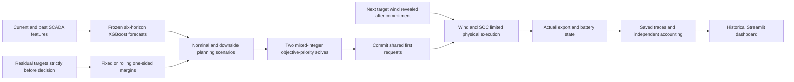

# Wind energy AI optimisation

**Raja Arqam Abdullah · MSc Artificial Intelligence · Teesside University**

A reproducible retrospective study of XGBoost wind forecasts at 10–60 minutes, causal one-sided uncertainty, and two-stage mixed-integer MPC for a simulated wind–battery system. The local demonstration replays verified research outputs; it is not a live wind-farm controller.

## What the research demonstrates

On 49 paired daily episodes (7,056 ten-minute transitions per controller), adaptive one-sided MPC uses **27.86% less battery throughput**, incurs **27.92% less modelled conversion loss**, and has **0.77% less summed ramp exceedance and 16 fewer violations** than frozen fixed-margin MPC. The development preference remains unchanged.

**Both MPC controllers worsen aggregate ramp exceedance, violation count and mean absolute ramp versus uncontrolled wind, although they reduce the maximum ramp.** This negative result is part of the research, not an implementation defect inferred from outcome alone.

| Strategy | Violations | Exceedance sum (kW) | Battery throughput (MWh AC) | Conversion loss (MWh) |
| --- | ---: | ---: | ---: | ---: |
| Uncontrolled wind | 1,465 | 317,210.288 | 0 | 0 |
| Fixed-margin MPC | 1,502 | 326,158.296 | 35.486898 | 1.821593 |
| Adaptive one-sided MPC | 1,486 | 323,638.526 | 25.598677 | 1.312916 |

Adaptive actual export is 0.987701 MWh lower than fixed; hypothetical terminal-SOC-adjusted export is 0.551229 MWh higher. Inventory adjustment is not additional realised export or a feasible restoration dispatch. XGBoost has lower RMSE but higher MAE than persistence at every horizon. Lower throughput does not establish longer battery lifetime.

The comparison is **retrospective**, not an untouched confirmatory test. Evaluation-period investigations predate the freeze. Development block 6 is excluded, but five of its six-horizon target timestamps overlap block 7 (15 forecast-target pairs and five scored h1 outcomes). Original scores are preserved and this issue is disclosed.

## Research package

- [Supervisor-review manuscript](docs/paper_submission_draft.md), including the complete mathematical appendix and actual figures/tables.
- [Grid-ramp diagnostic](docs/grid_ramp_diagnostic.md): exact injection identities, introduced/removed violations, forecast/scenario mismatch and representative event windows.
- [15-paper literature review](docs/literature_review.md), with primary sources, DOIs and bounded novelty claims.
- [Full mathematical formulation](docs/mathematical_formulation.md) and [methodology](docs/methodology.md).
- [Reproduction guide](docs/reproducibility.md), [verification report](docs/final_verification_report.md) and [unresolved scientific issues](docs/unresolved_scientific_issues.md).
- [Original v2 results](docs/heldout_results_v2.md) and [earlier paper draft](docs/paper_draft.md), preserved as historical artifacts.

## Architecture



The primary allowance is 100 kW on the weighted six-step exceedance sum. It is substantive lexicographic tolerance. The battery is 2,000 kWh / 1,000 kW, SOC 40–90%, initial SOC 50% per episode, and efficiency 95% each way. Charging is wind-only. The 1,000 kWh reserve is a soft objective target; the hard minimum is 800 kWh.

## Windows setup

Use Python 3.12. The existing working `.venv` is already tested. For a separate environment:

```powershell
py -3.12 -m venv .venv_review
.venv_review/Scripts/python.exe -m pip install -r requirements-research.txt -c docs/environment-frozen-evaluation.txt
```

The direct research/dashboard requirements and preserved transitive snapshot specify the tested package versions. A fresh network installation was not certified in this task. For saved-summary exploration only, `requirements-dashboard.txt` is the smaller dependency set. The historical `requirements.txt` is preserved and omits CVXPY/HiGHS.

## Launch the local dashboard

From the repository root:

```powershell
.venv/Scripts/python.exe -m streamlit run app/dashboard.py --server.address 127.0.0.1 --server.port 8501 --browser.gatherUsageStats false
```

Open **http://127.0.0.1:8501**. Substitute `.venv_review/Scripts/python.exe` if using the new environment. Select a controller, valid block and uncertainty horizon. Views show wind/export, battery power/SOC, ramps, throughput/losses, forecast accuracy, margins and paired comparisons; CSV export is available.

With local interval data missing, `docs/tables_v2/` supports aggregate-only exploration with an explicit warning. The optional replay button runs both unchanged frozen controllers for one selected block into a fresh UTC/UUID directory. It does not replace the historical data or tune a controller. Full local calibration/development/input artifacts and CVXPY/HiGHS are required.

## Verification and analysis commands

```powershell
.venv/Scripts/python.exe -B -m unittest discover -s tests -v
.venv/Scripts/python.exe -B scripts/verify_research_completion.py
```

For an additional frozen replay, choose a new run name:

```powershell
.venv/Scripts/python.exe scripts/run_frozen_heldout.py --run my_unique_replay --blocks 1
```

Omit `--blocks 1` for the unchanged full 49-block scope; then analyse it with:

```powershell
.venv/Scripts/python.exe scripts/analyse_frozen_heldout.py --run my_unique_replay
```

A one-block run is not a new full evaluation. The original runner skips any existing CSV without authenticating completeness; independently verify resumed outputs and do not use Python `-O`. Historical preparation/training scripts are unnecessary for replay and some overwrite outputs.

Additional diagnostics are produced by `scripts/build_completion_diagnostics.py`. Its current report/tables/figures already exist and exclusive creation prevents overwriting. Reproduce in a separate checkout where those new generated outputs are absent, with the original local inputs supplied. The [guide](docs/reproducibility.md) explains artifact requirements and versioning.

## Data, integrity and public-release limits

Source: [Wind Turbine SCADA Dataset, Berker Isen](https://www.kaggle.com/datasets/berkerisen/wind-turbine-scada-dataset), local file `data/raw/T1.csv`. The exact downloaded version, timezone, measurement aggregation and redistribution terms require author verification. Raw data, models, full traces, fine-grained diagnostic interval/event CSVs and audit solver replays are ignored by Git; a clone alone cannot reproduce the full simulation. Summary tables and figures are included in the research package, subject to release review. Local diagnostic exports still exist for analysis; do not force-add them before rights review.

The frozen manifest remains `results/development_controller_freeze_manifest.json`:

```text
b007aa5c57b5610ea75663d592b92816598c15658ed21bf0fcd99c107859895a
```

All frozen controllers, models, data, calibration and original results remain unchanged. Four explicitly authorised documentation/config files were archived before this completion update. No retraining, held-out tuning, scored-set change, Git push or external publication occurred.

There is no selected project licence or cleared public data archive. Before publication, curate the intended commit/tag and artifact access, review rights and bibliography, and obtain author/supervisor approval. Credential-pattern checks found no matches but do not guarantee secret-free history. Do not mirror internal refs or blindly force-add ignored artifacts.

## Citation placeholder

This is an unpublished working draft. **No journal citation, acceptance or research DOI is assigned.** After supervisor approval, replace this placeholder with the actual approved publication record. For current internal attribution: Raja Arqam Abdullah (2026), *Wind–battery predictive control with causal one-sided uncertainty: a retrospective comparison and diagnosis of realised ramp deterioration*, MSc research working draft, Teesside University.

## Repository map

| Path | Purpose |
| --- | --- |
| `app/dashboard.py`, `app/research_data.py` | Local historical replay and saved-data access |
| `scripts/frozen_*_heldout.py` | Preserved frozen controller implementations |
| `scripts/build_completion_diagnostics.py` | New read-only analysis |
| `scripts/verify_research_completion.py` | Integrity, accounting, tests and package checks |
| `scripts/build_submission_package.py` | Exclusive creation of the separate submission draft |
| `docs/completion_figures/`, `docs/completion_tables/` | Additional diagnostic evidence |
| `tests/` | Causality, physical accounting, ramp identity and dashboard checks |
| `audits/` | Prior independent audit and completion provenance |
