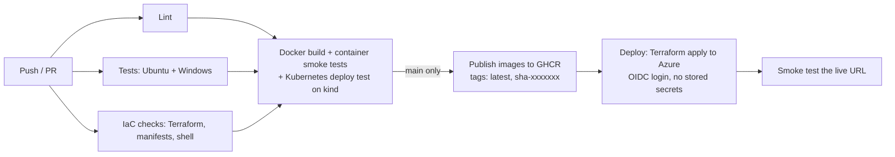

# Deployment

WindGrid ships as two container images, `windgrid-api` and `windgrid-dashboard`. They run in
three ways:

| Target | How | Used for |
|---|---|---|
| Docker Compose | `docker compose up --build` | local development, demos |
| Kubernetes | `kubectl apply -k deploy/k8s/base` | any cluster (AKS, EKS, GKE, on-premises); tested in CI on kind |
| Azure Container Apps | Terraform + GitHub Actions (automatic) | the public deployment |

## Pipeline



- `.github/workflows/ci.yml` runs on every push and pull request.
- `.github/workflows/deploy.yml` runs after CI succeeds on `main`, or manually. It deploys the exact
  image built from that commit (`sha-xxxxxxx`), so every deployment can be traced to a commit.

## Azure: one-time setup (about 10 minutes)

1. **Azure account:** sign up for [Azure for Students](https://azure.microsoft.com/free/students)
   with your university email (no credit card).
2. **Run the bootstrap in Azure Cloud Shell:** in [portal.azure.com](https://portal.azure.com)
   click the `>_` icon, choose **Bash**, and paste:

   ```bash
   curl -fsSL https://raw.githubusercontent.com/arqam3025/wind-energy-ai-optimisation/main/deploy/azure/bootstrap.sh | bash
   ```

   It creates the Terraform state storage and a managed identity that GitHub Actions signs in as
   through OpenID Connect. That identity trusts only this repository's `main` branch. The script
   prints four values.
3. **Add the four values to GitHub** as repository **variables** (not secrets; they are
   identifiers): *Settings → Secrets and variables → Actions → Variables*: `AZURE_CLIENT_ID`,
   `AZURE_TENANT_ID`, `AZURE_SUBSCRIPTION_ID`, `TFSTATE_STORAGE`.
4. **Make the two images public** (one time): *GitHub profile → Packages → windgrid-api /
   windgrid-dashboard → Package settings → Change visibility → Public*.
5. **Deploy:** *Actions → Deploy (Azure) → Run workflow*. Every later merge to `main` deploys
   automatically. The run summary shows the API and dashboard URLs.

If Azure rejects the region (student subscriptions allow only some regions), set `location` in
`deploy/azure/terraform/variables.tf` to an allowed region, for example `westeurope`. Re-run the
bootstrap with `LOCATION=westeurope`.

## Cost

Both apps scale to zero when idle. The first request after a quiet period takes a few seconds while
a container starts. Usage at demo scale stays within the Azure Container Apps monthly free grant.
Log Analytics has a 0.5 GB daily cap and 30-day retention. To remove everything:

```bash
az group delete -n rg-windgrid --yes          # the application
az group delete -n rg-windgrid-tfstate --yes  # state storage and deployment identity
```

## Kubernetes details (`deploy/k8s/`)

- **API:** 2 replicas, rolling updates with zero unavailability, readiness and liveness probes on
  `/health`, CPU/memory requests and limits, a HorizontalPodAutoscaler (2–6 replicas at 70% CPU)
  and a PodDisruptionBudget.
- **Container security:** non-root user, read-only root filesystem (API), all Linux capabilities
  dropped, a seccomp profile, and the namespace enforcing the `restricted` Pod Security Standard.
- **Dashboard:** one replica with session affinity, because Streamlit sessions are held in memory.
- **Ingress:** `/api/*` goes to the API and `/` to the dashboard (ingress-nginx).
- `overlays/ci` swaps in the CI-built images and drops the Ingress and HPA. The throwaway kind
  cluster has no ingress controller or metrics server.
