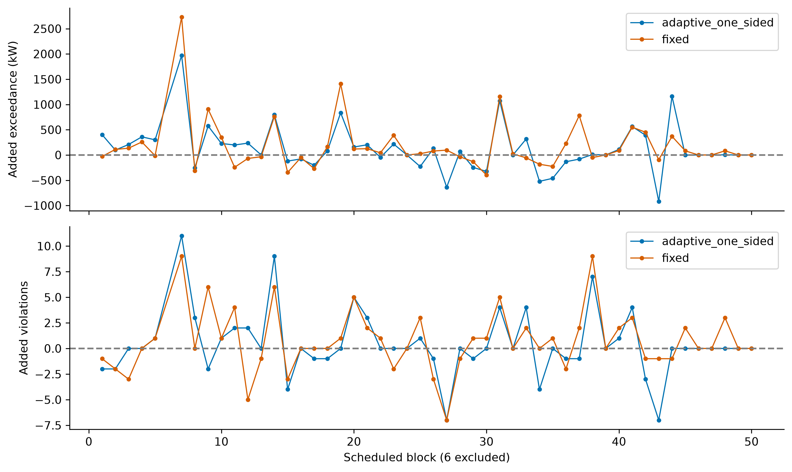
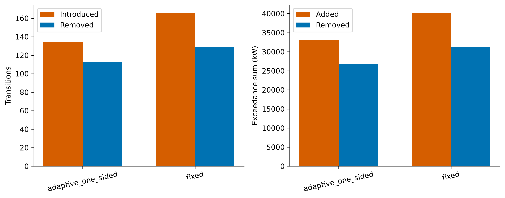
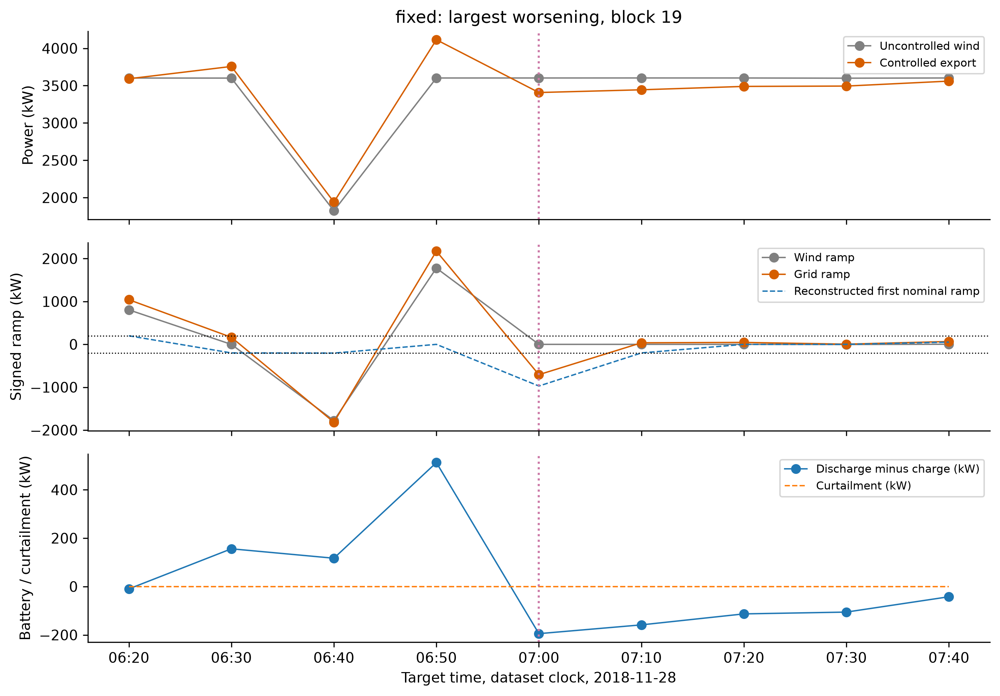
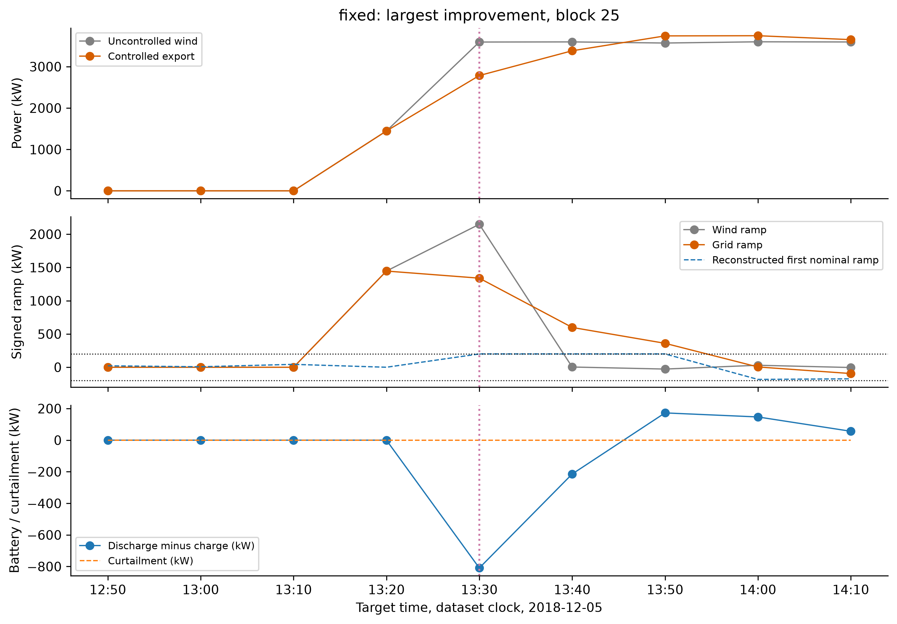
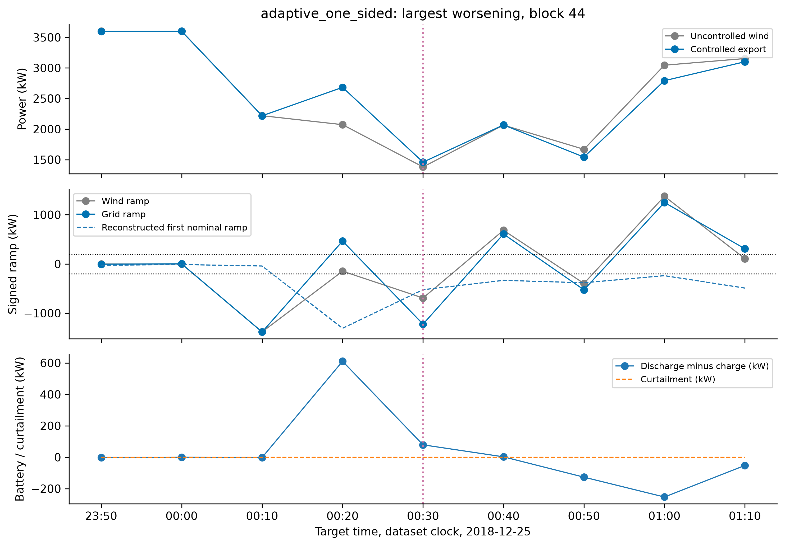
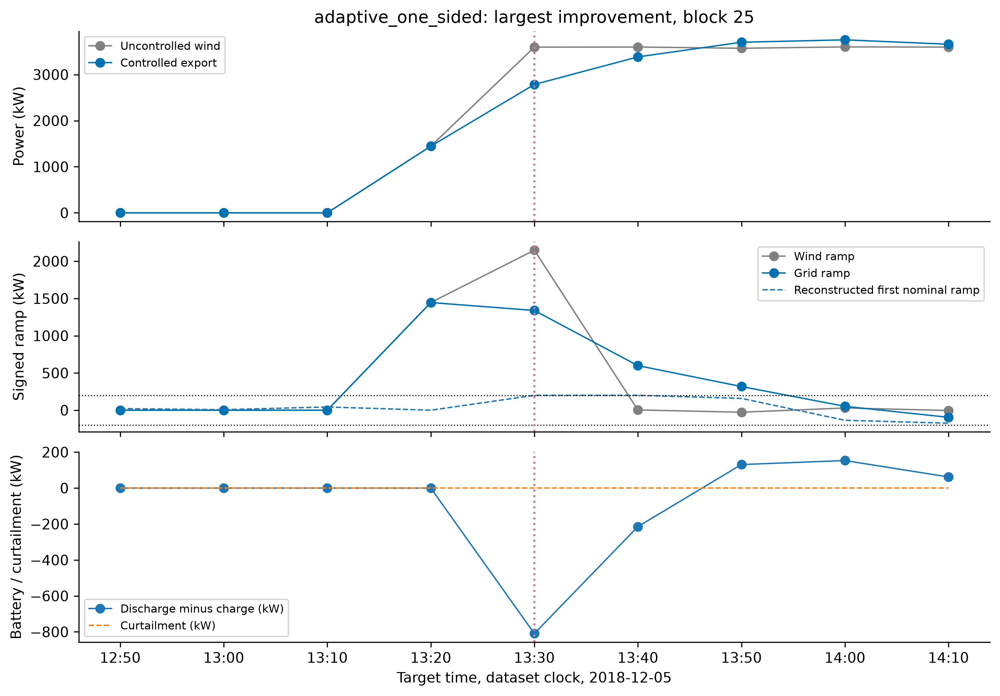
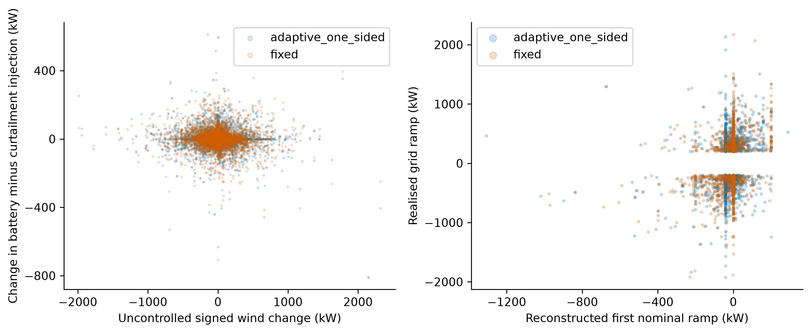
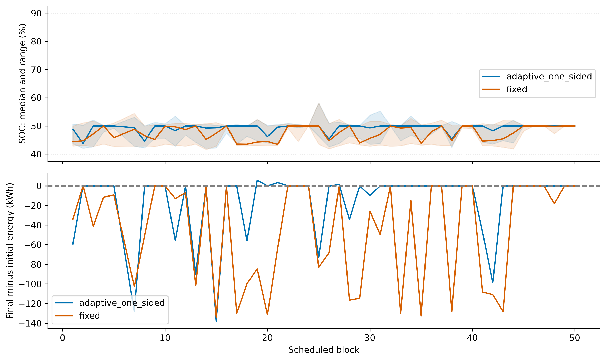

# Grid-ramp diagnostic of the unchanged frozen comparison

29 October 2026. This is a post-hoc, read-only diagnostic, not a new controller experiment. It preserves all 49 scored episodes and their original results. The reserved-period comparison is retrospective; historical test inspection and development-target overlap prevent a clean confirmatory interpretation.

## Verified accounting and principal finding

| strategy | violations | exceedance_kw | throughput_kwh | conversion_losses_kwh |
| --- | --- | --- | --- | --- |
| uncontrolled | 1465 | 317,210.288 | 0.000 | 0.000 |
| fixed | 1502 | 326,158.296 | 35,486.898 | 1,821.593 |
| adaptive_one_sided | 1486 | 323,638.526 | 25,598.677 | 1,312.916 |

Both battery controllers worsen aggregate exceedance and violation counts relative to uncontrolled wind. Adaptive one-sided improves on fixed margins but does not demonstrate net mitigation in these metrics. The original 27.86% throughput reduction, approximately 27.92% conversion-loss reduction, 0.77% exceedance reduction and 16 fewer violations versus fixed are unchanged.

For every episode, both baselines use the same target times, origin current power, nonnegative wind, 200 kW threshold, >200.001 kW violation test and 144 transitions. The first transition is origin current power to the first target; later transitions are within the episode. No cross-episode transition is added. The battery begins at 1,000 kWh with zero prior battery/curtailment injection. All 98 traces satisfy power and stored-energy conservation, SOC 40–90%, power bounds and wind-only charging. This diagnostic did not identify a transition-counting or physical-balance implementation bug explaining the negative finding.

## Exact ramp attribution

Let `b = discharge - charge` and `j = b - curtailment`. The measured identity is:

`signed_grid_ramp = signed_wind_ramp + (j[k] - j[k-1])`, with `j[-1]=0` at episode initialization.

This identity held to numerical tolerance for every controlled interval. A change in battery injection can either cancel a wind change or reinforce it. Charging during one interval also changes the reference export for the next interval. Consequently, the sign of current charge/discharge alone does not establish whether a transition is improved.

| controller | introduced_violations | removed_violations | net_additional_violations | gross_exceedance_added_kw | gross_exceedance_removed_kw | net_exceedance_added_kw |
| --- | --- | --- | --- | --- | --- | --- |
| adaptive_one_sided | 134 | 113 | 21 | 33,187.114 | 26,758.877 | 6,428.237 |
| fixed | 166 | 129 | 37 | 40,241.350 | 31,293.343 | 8,948.008 |

Gross added and removed exceedance refer to `controlled_exceedance - uncontrolled_exceedance` at paired transitions. Their difference is the observed net deterioration; they are not energy quantities. Introduced violations are transitions below threshold without control but above threshold with control; removed violations reverse that classification.

## Representative intervals: deliberately selected diagnostic extremes

The examples below are selected by the largest positive and negative change in exceedance for each controller. They illustrate mechanisms, not typical or independent evidence; no favourable event selection informs controller choice.

| controller | selection_rule | block_id | interval | target_time | wind_ramp_kw | grid_ramp_kw | exceedance_change_kw | charge_kw | discharge_kw | soc_percent |
| --- | --- | --- | --- | --- | --- | --- | --- | --- | --- | --- |
| adaptive_one_sided | largest_worsening | 44 | 74 | 2018-12-25 00:30:00 | -692.038 | -1,223.488 | 531.450 | 0.000 | 78.998 | 43.964 |
| adaptive_one_sided | largest_improvement | 25 | 126 | 2018-12-05 13:30:00 | 2,148.607 | 1,339.146 | -809.461 | 809.461 | 0.000 | 56.408 |
| fixed | largest_worsening | 19 | 107 | 2018-11-28 07:00:00 | 0.095 | -706.980 | 506.980 | 194.712 | 0.000 | 46.681 |
| fixed | largest_improvement | 25 | 126 | 2018-12-05 13:30:00 | 2,148.607 | 1,339.160 | -809.447 | 809.447 | 0.000 | 56.408 |

The CSV `completion_tables/representative_intervals.csv` also contains requested/realised commands, previous export, forecast error, reconstructed scenario ramps and stored energy. Local event windows preserve each controller's actual prior export and do not restart the simulation at the event.

- **adaptive_one_sided, largest worsening, block 44 at 2018-12-25 00:30:00:** the wind change is -692.038 kW. Net battery-minus-curtailment injection changes from +610.448 to +78.998 kW, adding -531.450 kW to that wind change. The resulting grid change is -1223.488 kW. The reconstructed first nominal ramp is -522.978 kW and actual wind minus nominal forecast is -700.510 kW. This is an exact trajectory decomposition; it does not identify why the full-horizon optimum preferred that command.
- **adaptive_one_sided, largest improvement, block 25 at 2018-12-05 13:30:00:** the wind change is +2148.607 kW. Net battery-minus-curtailment injection changes from +0.000 to -809.461 kW, adding -809.461 kW to that wind change. The resulting grid change is +1339.146 kW. The reconstructed first nominal ramp is +200.000 kW and actual wind minus nominal forecast is +1139.146 kW. This is an exact trajectory decomposition; it does not identify why the full-horizon optimum preferred that command.
- **fixed, largest worsening, block 19 at 2018-11-28 07:00:00:** the wind change is +0.095 kW. Net battery-minus-curtailment injection changes from +512.363 to -194.712 kW, adding -707.075 kW to that wind change. The resulting grid change is -706.980 kW. The reconstructed first nominal ramp is -972.308 kW and actual wind minus nominal forecast is +265.328 kW. This is an exact trajectory decomposition; it does not identify why the full-horizon optimum preferred that command.
- **fixed, largest improvement, block 25 at 2018-12-05 13:30:00:** the wind change is +2148.607 kW. Net battery-minus-curtailment injection changes from +0.000 to -809.447 kW, adding -809.447 kW to that wind change. The resulting grid change is +1339.160 kW. The reconstructed first nominal ramp is +200.014 kW and actual wind minus nominal forecast is +1139.146 kW. This is an exact trajectory decomposition; it does not identify why the full-horizon optimum preferred that command.

## Predicted versus realised first-step ramps

The saved traces contain requested first-step charge, discharge and curtailment, plus nominal/downside wind. For each scenario, this diagnostic reconstructs `charge=min(request, scenario wind)` and `curtail=min(request, scenario wind-charge)`, then computes predicted first export and its change from the **actual previous controlled export**. This reproduces the frozen first-step scenario relations without solving or altering the optimisation.

| controller | realised_violations_with_both_first_predictions_safe | realised_violations_with_nominal_prediction_safe | wind_or_safety_limited_charge_intervals | safety_limited_discharge_intervals |
| --- | --- | --- | --- | --- |
| adaptive_one_sided | 59 | 1435 | 85 | 0 |
| fixed | 38 | 1428 | 152 | 0 |

Realised violations despite both reconstructed first scenarios being within threshold demonstrate forecast/scenario mismatch for those transitions. They do not prove which term caused a particular optimiser choice, nor provide stage-one/stage-two full-horizon objective values. The weighted reconstructed first-step exceedance is only one component of the six-step objective, evaluated at the committed command.

The 100 kW primary allowance permits the secondary solution to be up to 100 kW worse than the **predicted weighted six-step** primary optimum. It is not a cap on the realised ramp or an allowance applied independently to every interval. The primary target uses nominal/downside forecasts, not actual future wind. The secondary cost additionally penalises absolute ramps, battery ramps, throughput, terminal SOC deviation, curtailment and reserve shortfall. Minimising that forecast-based objective does not guarantee improving realised ramps over the realised uncontrolled trajectory.

## SOC, reserve, commands and energy trade-offs

| controller | below_reserve_intervals | at_lower_bound_intervals | at_upper_bound_intervals |
| --- | --- | --- | --- |
| adaptive_one_sided | 2281 | 0 | 0 |
| fixed | 4186 | 0 | 0 |

Counts refer to end-of-interval energy: below the 1,000 kWh soft reserve, within 0.01 kWh of the 800 kWh lower bound, or within 0.01 kWh of the 1,800 kWh upper bound. They diagnose operation, not independent infeasibility; the hard bounds remain satisfied. `wind_or_safety_limited_charge` records request minus realised charge >0.001 kW and does not independently distinguish every limiting cause.

| controller | operating_mode | intervals | introduced | removed | exceedance_added_kw | mean_absolute_forecast_error_kw |
| --- | --- | --- | --- | --- | --- | --- |
| adaptive_one_sided | charging | 1432 | 75 | 51 | 3,433.843 | 192.975 |
| adaptive_one_sided | discharging | 1689 | 53 | 58 | 2,380.700 | 196.508 |
| adaptive_one_sided | idle | 3935 | 6 | 4 | 613.694 | 75.646 |
| fixed | charging | 2084 | 95 | 58 | 5,249.652 | 169.733 |
| fixed | discharging | 2681 | 64 | 67 | 2,939.235 | 163.891 |
| fixed | idle | 2291 | 7 | 4 | 759.121 | 49.234 |

Grouping by current operating mode is descriptive. Ramp outcomes depend on the change in battery injection and previous controlled export, so these groups cannot identify the causal effect of charging or reserve penalties.

Actual export, curtailment, modelled losses and inventory changes are in `completion_tables/block_diagnostic_metrics.csv`. The identity `wind energy = export + curtailment + conversion losses + inventory change` is checked. Actual and hypothetical terminal-adjusted export must remain separate: the adjustment is not a feasible restoration dispatch or additional realised generation.

## Development versus reserved-period behaviour

| period | controller | blocks | throughput_kwh_per_interval | violation_rate_percent | exceedance_kw | actual_export_mwh | adjusted_export_mwh |
| --- | --- | --- | --- | --- | --- | --- | --- |
| development | fixed | 18 | 5.420 | 26.968 | 128,691.409 | 586.635 | 585.895 |
| reserved_evaluation | fixed | 49 | 5.029 | 21.287 | 326,158.296 | 1,801.383 | 1,799.022 |
| development | adaptive_one_sided | 18 | 3.051 | 27.392 | 127,842.956 | 586.405 | 586.240 |
| reserved_evaluation | adaptive_one_sided | 49 | 3.628 | 21.060 | 323,638.526 | 1,800.396 | 1,799.573 |

Development showed throughput reduction 43.70%, exceedance reduction 0.66%, and 11 **additional** violations for adaptive versus fixed. The reserved-period differences are 27.86%, 0.77%, and 16 fewer violations. Different observation counts and weather mean raw totals across these periods should not be compared as if exposures were equal. The table provides per-interval throughput and violation rates but does not convert this observational comparison into a causal distribution-shift estimate.

## Temporal dependence and heterogeneity

| segment_id | blocks | exceedance_difference_kw | violations_difference | throughput_difference_kwh |
| --- | --- | --- | --- | --- |
| 1 | 5 | 908.152 | 2 | -1,853.325 |
| 2 | 18 | -872.671 | 4 | -2,784.760 |
| 3 | 12 | -1,534.399 | -5 | -2,740.476 |
| 4 | 14 | -1,020.852 | -17 | -2,509.660 |

Differences are adaptive minus fixed. The four chronological segments do not show uniform violation improvement. They are only four segments, not four assured independent replications.

| metric | lag_blocks | within_segment_pairs | pearson_correlation |
| --- | --- | --- | --- |
| exceedance_kw | 1 | 45 | -0.201 |
| exceedance_kw | 2 | 41 | 0.082 |
| exceedance_kw | 3 | 37 | -0.005 |
| violations | 1 | 45 | -0.125 |
| violations | 2 | 41 | 0.060 |
| violations | 3 | 37 | -0.354 |
| throughput_kwh | 1 | 45 | -0.086 |
| throughput_kwh | 2 | 41 | 0.147 |
| throughput_kwh | 3 | 37 | -0.163 |

Lag correlations use adjacent daily blocks within the same contiguous segment; gaps are not bridged. These correlations are descriptive diagnostics with limited sample sizes, not a fitted stochastic model. The existing ordinary paired day-bootstrap resamples days independently. Its intervals must remain labelled descriptive and are not dependence-adjusted confidence intervals. No new bootstrap method, significance test, controller choice or scored-set modification was introduced by this diagnostic.

## Classification of findings

| Category | Evidence and interpretation |
| --- | --- |
| Confirmed scientific-design problem | Prior evaluation-period inspection predates the freeze. Excluding development block 6 by origin still leaves five measured target times shared with block 7 (15 horizon-target pairs and five scored h1 outcomes). The existing preflight omits block 6 from its development-overlap inputs. This prevents an untouched, target-disjoint confirmatory claim; it is distinct from runtime causal residual eligibility. |
| Confirmed reporting/diagnostic limit | Original CSVs do not retain full planned trajectories, stage-one optimum, stage-two achieved primary, solver gaps or per-step solve times. Full-stage causal attribution cannot be recovered from these traces. No such values are invented here. |
| Confirmed implementation checks passed | Same transition definitions and timestamps; 144 transitions per episode; physical balance, SOC/power limits and no simultaneous charging/discharging. No serious physical or ramp-accounting implementation error was found in these checks. |
| Expected optimisation trade-off | Requests optimise forecast-based scenarios and a composite secondary objective, with a frozen 100 kW primary allowance. Actual wind can differ from both scenarios, and reserve/terminal/curtailment/battery-ramp costs can change actions. These are demonstrated design properties, not proven individual causal contributions. |
| Modelling limitation | Soft ramps, two downward scenarios, scenario-dependent future recourse, short horizon, episode resets and idealised wind-limited execution do not guarantee actual ramp mitigation. No hard realised-ramp or network constraint is implemented. |
| Hypothesis requiring a new experiment | Reserve penalty, 100 kW allowance, asymmetric scenario coverage, horizon length and end-of-episode inventory incentives may each contribute to deterioration. Establishing their separate effects requires predeclared development-only ablations or genuinely new evaluation data, with new frozen versions and filenames. |

The existing aggregate adaptive-versus-fixed arithmetic remains supported. Claims of clean confirmatory generalisation or improved uncontrolled-wind ramp performance must stop. No controller or evaluated set was changed to obtain more favourable results.

## Reproduction and artifacts

Run `python scripts/build_completion_diagnostics.py` from the repository root in a fresh output checkout. It requires the original local inputs and exclusively creates this report, `docs/completion_tables/` and `docs/completion_figures/`; it refuses to overwrite existing outputs. Source SHA256 values and scope are recorded in `completion_tables/diagnostic_provenance.json`. Every figure is available as 300 dpi PNG and vector PDF. Original models, calibration, controllers and evaluation outputs are read only.
