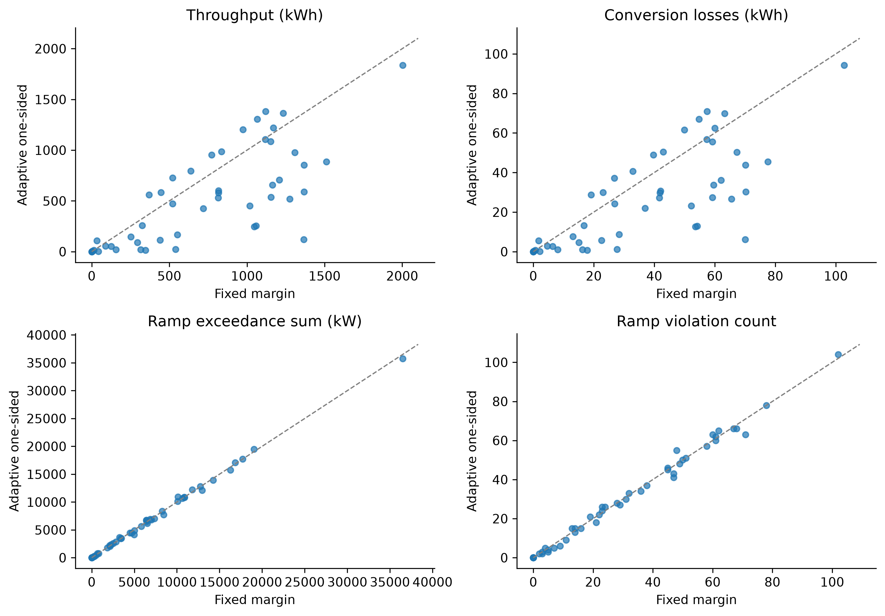
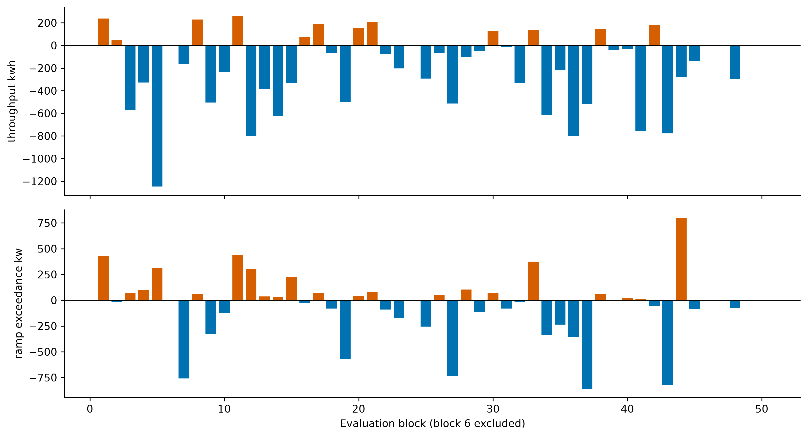
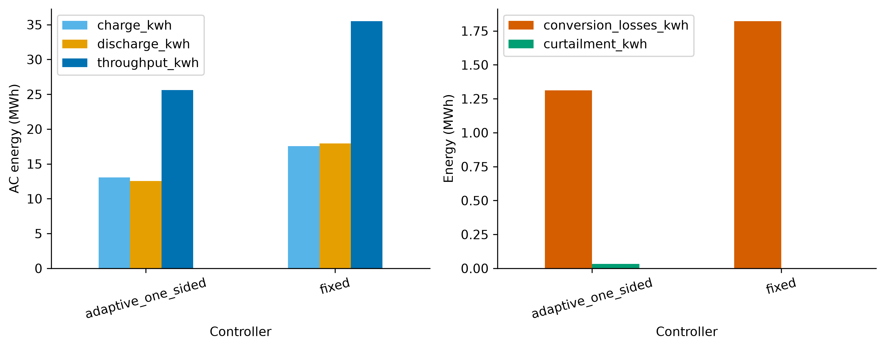
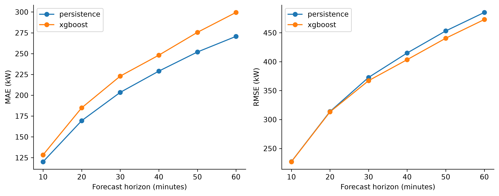
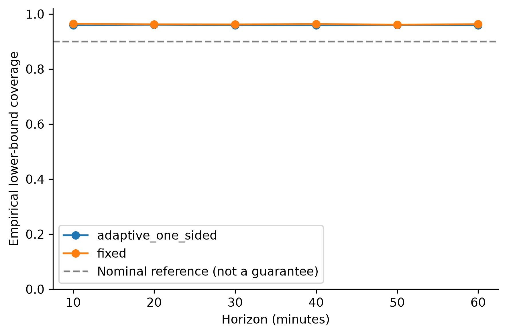
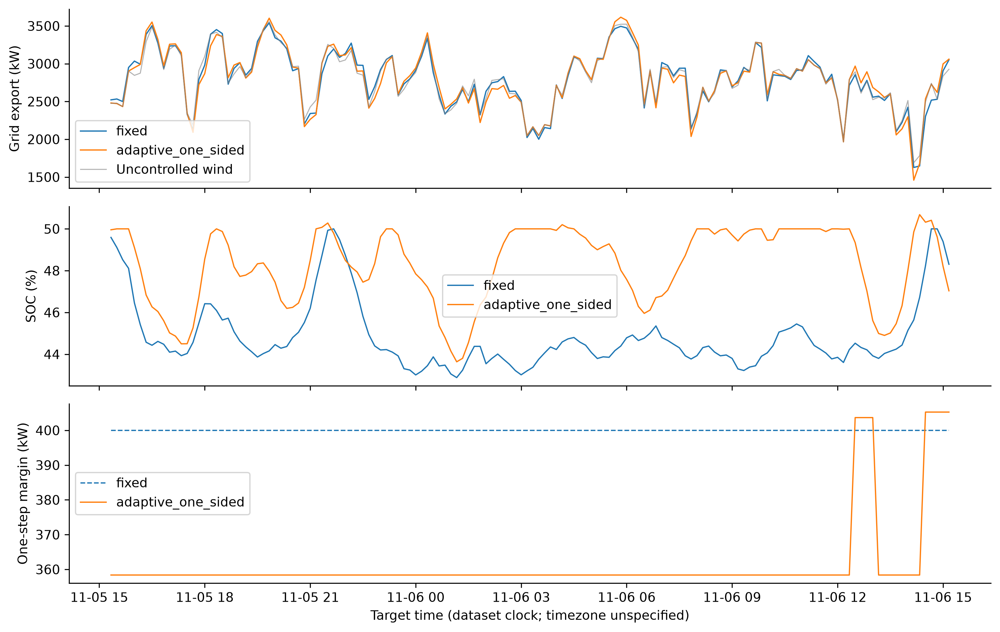

# Frozen held-out results

The frozen comparison completed **49 paired blocks (7,056 intervals per controller)**. Relative to fixed margins, adaptive one-sided throughput changed by **-27.86%**, summed ramp exceedance by **-0.77%**, and violation count by **-16**. The development preference remains frozen; these outcomes do not trigger controller selection or re-tuning.

| Metric | Fixed margin | Adaptive one-sided | Adaptive minus fixed |
| --- | ---: | ---: | ---: |
| Ramp violations | 1,502 | 1,486 | -16 |
| Violation rate (%) | 21.29 | 21.06 | -0.23 |
| Ramp exceedance sum (kW) | 326,158.296 | 323,638.526 | -2,519.770 |
| Battery throughput (MWh) | 35.486898 | 25.598677 | -9.888221 |
| Conversion losses (MWh) | 1.821593 | 1.312916 | -0.508678 |
| Curtailment (MWh) | 0.000000 | 0.033385 | +0.033385 |
| Actual grid export (MWh) | 1,801.383303 | 1,800.395602 | -0.987701 |
| Terminal-SOC-adjusted export (MWh) | 1,799.021589 | 1,799.572818 | +0.551229 |

All 98 controller-block outputs passed independent physical and energy audits. All 42,336 horizon targets matched raw measurements. First-block replay had zero numeric difference for both controllers on the installed stack. The freeze and all 736 inventoried pre-existing research artifacts remained unchanged. Terminal-SOC-adjusted energy is hypothetical restoration accounting; actual export is reported separately.

Uncontrolled wind has 1,465 violations and 317,210.288 kW summed exceedance on the same transitions. It is a descriptive physical reference and was not used for controller selection.

| Outcome | Mean paired difference | Median paired difference | Negative blocks | Positive blocks | Ties |
| --- | ---: | ---: | ---: | ---: | ---: |
| throughput_kwh | -201.8004 | -104.7577 | 32 | 12 | 5 |
| conversion_losses_kwh | -10.3812 | -5.4765 | 32 | 12 | 5 |
| ramp_exceedance_kw | -51.4239 | 0.0000 | 22 | 21 | 6 |
| ramp_violations | -0.3265 | 0.0000 | 21 | 14 | 14 |
| terminal_adjusted_export_kwh | 11.2496 | 7.2073 | 12 | 32 | 5 |

Negative differences favour adaptive for throughput, losses and ramp costs; positive differences favour adaptive for adjusted export. Bootstrap intervals in the CSV are descriptive because adjacent blocks are dependent.

| Horizon (min) | XGBoost MAE (kW) | Persistence MAE (kW) | XGBoost RMSE (kW) | Persistence RMSE (kW) |
| --- | ---: | ---: | ---: | ---: |
| 10 | 128.388 | 120.122 | 227.070 | 227.234 |
| 20 | 184.849 | 169.411 | 313.187 | 313.811 |
| 30 | 222.971 | 203.445 | 367.173 | 372.805 |
| 40 | 248.113 | 228.966 | 403.508 | 415.037 |
| 50 | 275.550 | 251.946 | 440.551 | 453.165 |
| 60 | 299.455 | 270.685 | 472.869 | 485.127 |

| Horizon (min) | Fixed lower-bound coverage (%) | Adaptive lower-bound coverage (%) |
| --- | ---: | ---: |
| 10 | 96.43 | 95.98 |
| 20 | 96.24 | 96.10 |
| 30 | 96.20 | 95.96 |
| 40 | 96.36 | 95.92 |
| 50 | 96.10 | 95.99 |
| 60 | 96.30 | 95.96 |

Coverage is empirical marginal lower-bound coverage, not simultaneous or guaranteed coverage. Forecast comparisons reuse stored predictions and do not inform re-tuning.

Local run: `final_20261029`; analysis: `analysis_v1`. Full tables are in [tables/](tables/).
