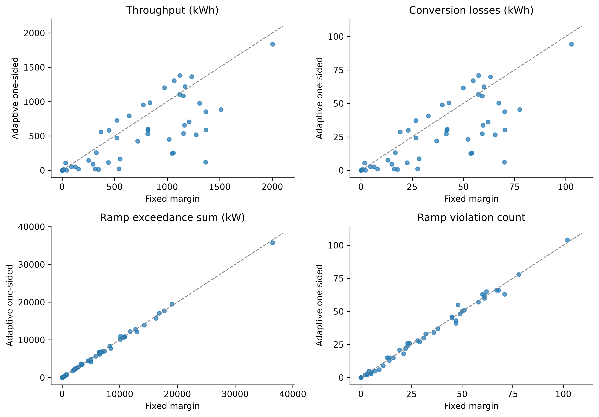
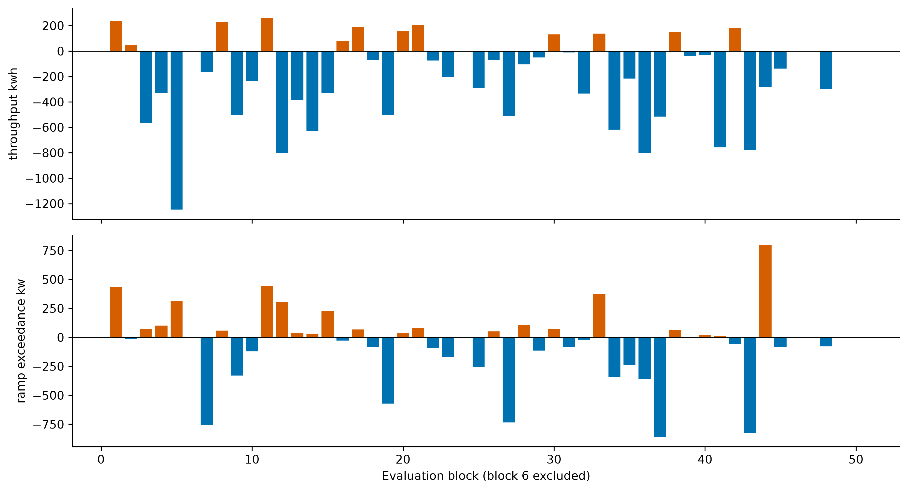
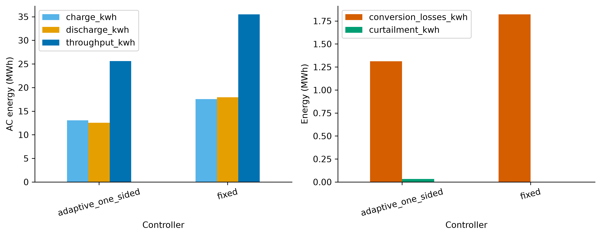
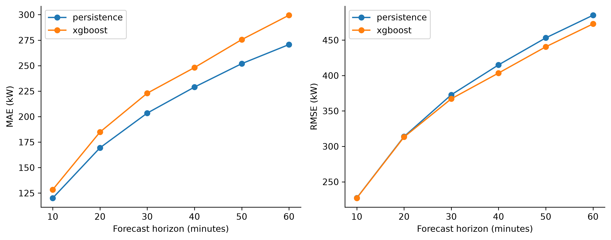
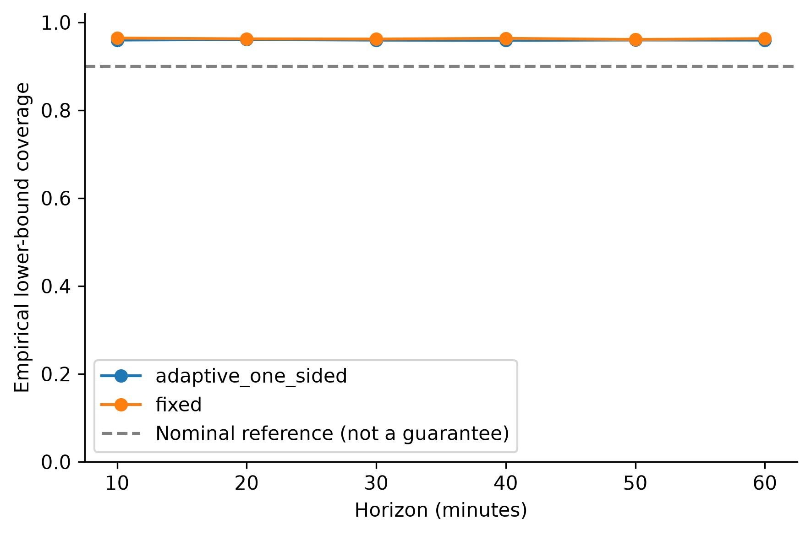
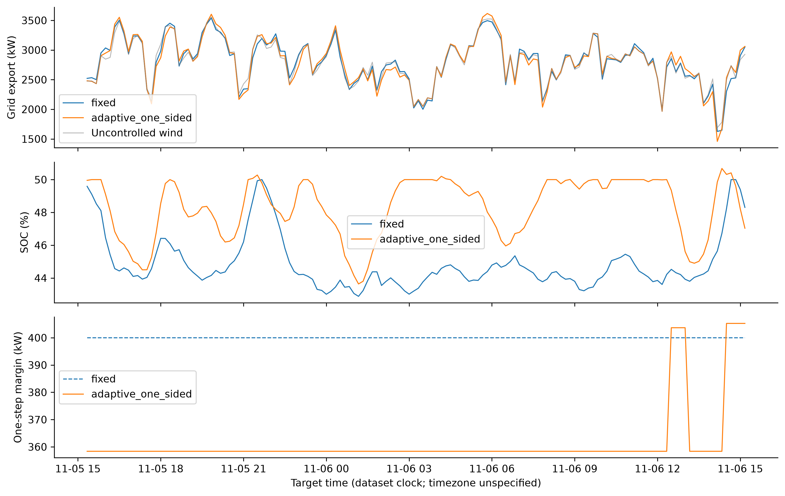

# Causal one-sided forecast uncertainty for wind–battery ramp mitigation: a frozen comparison of two-stage mixed-integer predictive controllers

Raja Arqam Abdullah — MSc Artificial Intelligence, Teesside University

Research paper draft, 29 October 2026. Local computational study; not a claim of field deployment or independent external replication.

## Abstract

Short-horizon wind forecast uncertainty affects battery dispatch for grid-ramp mitigation. This study compares a frozen fixed-margin controller with a development-selected rolling one-sided uncertainty controller using the same six-horizon XGBoost forecasts and two-stage mixed-integer model predictive control. The primary optimisation minimises predicted ramp exceedance; a secondary optimisation admits a frozen 100 kW primary tolerance and minimises operational penalties. Residual target timestamps must precede each decision strictly. Forty-nine scheduled held-out episodes contain 7,056 ten-minute control intervals per controller; a fiftieth episode is excluded because its provenance explicitly identifies development use. Validation includes raw-data target lookup, physical power and stored-energy conservation, causal intervention tests, and an independent first-episode replay. On these episodes, adaptive one-sided battery throughput changed by -27.86%, summed ramp exceedance by -0.77%, and ramp violation count by -16 relative to fixed margins. These outcomes describe a trade-off and do not establish universal controller superiority. This is an offline single-turbine study with episode resets, dependent observations and simplified battery dynamics; lower throughput is not evidence of a quantified battery-lifetime or grid-compliance benefit.

## 1. Introduction

Wind generation variability creates a control problem that cannot be assessed using point-forecast accuracy alone. Battery smoothing can reduce export changes, but consumes conversion energy and exposes storage to cycling. An uncertainty-aware controller may sacrifice throughput, curtailment or energy inventory to change ramp outcomes. A useful evaluation therefore considers violations, exceedance magnitude, battery usage and energy accounting jointly.

The research question is whether replacing fixed absolute-error margins with causal rolling overprediction margins improves this trade-off under otherwise frozen control and physical assumptions. The contribution is a traceable empirical comparison rather than a new conformal coverage theorem: strict timestamp eligibility, executable frozen controller adaptations, paired held-out accounting and disclosure of the development-selection trade-off.

XGBoost provides the tree-boosting forecasting method [1]. Conformal prediction motivates finite-sample quantile calibration [2], while dependent and shifting time series require care in interpreting coverage [3]. The implementation here updates residual windows with fixed alpha; it does not implement the adaptive-alpha procedure of [3] and does not inherit its guarantees.

## 2. Data and forecasting

The local SCADA source `T1.csv` contains measured active power, wind speed, wind direction and a theoretical power curve. The data source is the Wind Turbine SCADA Dataset [4]; redistribution rights and exact acquisition provenance should be retained with any public release. Dataset-clock timestamps are treated as naive times, with exact ten-minute target offsets. Generation used in physical simulation is clipped to zero. Missing periods define separate contiguous segments rather than being interpolated.

The existing six-model XGBoost implementation uses current power and meteorological measurements, historical timestamp-joined lags, changes and a recent power mean. The archived training configuration specifies 300 estimators, depth 4, learning rate 0.05, subsample 0.8, column subsample 0.9 and random seed 42. Training targets precede 9 September 2018 02:50; validation targets precede 5 November 2018 15:10. The present experiment reuses stored forecasts and never calls a training routine. Persistence provides the forecast baseline.

The audited validation predictions were split chronologically into calibration and controller development. Eighteen development episodes determined the preferred adaptive one-sided controller before this evaluation. Development throughput was 43.70% lower and total exceedance 0.66% lower than fixed margins, but violation count increased from 699 to 710. That mixed result motivated a frozen comparison, not a prior claim of superiority.

The evaluation schedule has fifty complete 144-origin episodes. Block 6, 14–15 November 2018, is explicitly labelled development by the schedule-generation code; a separate development-preparation script explains its misleading evaluation CSV filename. It is excluded. The remaining 49 blocks form the scored set. Historical evaluation outputs already exist in the repository, so the experiment must not be described as a wholly blinded first examination of the underlying test period.

## 3. Causal uncertainty

For horizon h, define signed overprediction residual `r(s,h) = forecast(s,h) - actual(s+10h minutes)`. At decision t, only residuals with `s+10h minutes < t` are eligible. The last 144 eligible residuals produce the order statistic at rank `ceil(145*0.9) = 131`. A horizon-specific static floor lower-bounds this rolling margin, except that a frozen post-gap fallback directly uses the floor until at least 72 selected origins follow the specified gap boundary.

The adaptive floors are approximately 358.380, 504.729, 571.614, 630.176, 690.978 and 731.662 kW. The fixed absolute-error calibration margins are approximately 400.014, 536.120, 608.362, 673.969, 727.957 and 786.613 kW. These distinct frozen values are preserved. For each horizon the lower scenario is `max(0, nominal-margin)`, and nominal forecasts are also nonnegative.

History combines frozen calibration and development observations with scheduled evaluation-block observations. Strict per-horizon target filtering permits online use of past held-out outcomes without using future outcomes or fitting a new forecasting model. Block 6 may supply already observed history but never contributes scored outcomes. Battery resets do not reset the uncertainty history. Coverage is measured empirically, separately at each horizon. Serial dependence, floors and fallback prevent a general nominal-coverage guarantee here.

## 4. Two-stage mixed-integer MPC

Each controller plans six ten-minute intervals with equal nominal/downside scenario weights. The 2,000 kWh battery has 1,000 kW charge/discharge ratings, 40–90% SOC bounds and 95% charge/discharge efficiencies. Initial energy is 1,000 kWh per episode. With charging c, discharging d, curtailment u, generation w and grid export g:

`g = w - u - c + d`

`E[k+1] = E[k] + 0.95*c[k]/6 - d[k]/(6*0.95)`.

Binary modes prevent simultaneous charge and discharge. Export is nonnegative; charging uses available wind only, and curtailment cannot exceed remaining wind. Shared first-stage commands and exact minimum constraints implement wind-limited realisation across scenarios. Later planned commands may depend on scenario.

Stage 1 minimises weighted predicted exceedance above an absolute 200 kW inter-interval ramp. Stage 2 constrains primary cost to the first-stage optimum plus 100 kW, then minimises the frozen weighted operational cost: absolute grid ramps, battery ramps, exceedance, throughput, terminal-energy deviation, curtailment and reserve shortfall. The full objective coefficients are recorded in [methodology.md](methodology.md). The 100 kW tolerance means the method is lexicographic with tolerance, not exact lexicographic optimality. Both stages require an optimal HiGHS status through CVXPY [5,6].

Committed requests are obtained before actual next-interval wind is accessed. The physical simulator caps charge at available wind, power and SOC capacity; discharge at power and the minimum-energy constraint; and curtailment at wind left after charging. Actual export and SOC update the next state. Identical frozen optimisation and execution bodies are verified structurally between development and evaluation copies.

## 5. Evaluation and accounting

Each block contributes 144 transitions, including current wind at the initial origin to first controlled export. A violation exceeds 200.001 kW; total exceedance sums `max(abs(ramp)-200,0)` in kW. This is not an energy metric. Report the uncontrolled wind trace as a descriptive ramp reference, alongside paired fixed/adaptive comparisons. Forecast MAE/RMSE and empirical lower-bound coverage provide separate predictive diagnostics.

AC battery throughput sums charged and discharged kWh. Conversion losses equal `0.05*charged_kWh + (1/0.95-1)*discharged_kWh`. The independent balance is `wind_energy = export_energy + curtailment_energy + conversion_losses + delta_stored_energy`. Terminal-adjusted energy adds 0.95 times surplus stored energy or subtracts deficit energy divided by 0.95. This hypothetical restoration value is reported alongside actual export; no restoration trajectory is simulated.

Raw lookup checks all 42,336 horizon-target pairs against clipped measurements. Independent validations check timestamp alignment, per-step stored-energy conservation, bounds, power ratings, wind-only charging, curtailment, export, command caps and strictly causal uncertainty diagnostics. A counterfactual test changes equal/future outcomes and requires unchanged current margins. Repeated first-block solves test reproducibility on the installed stack.

Differences use adaptive minus fixed within each block. Paired distributions, totals and block signs are presented. Seeded 10,000-replicate paired block bootstrap intervals describe variation under block resampling; temporal dependence means these should not be interpreted as confirmatory confidence intervals or evidence of independent replications.

## 6. Results

<!-- HELDOUT_RESULTS_START -->
The frozen comparison completed **49 paired blocks (7,056 intervals per controller)**. Relative to fixed margins, adaptive one-sided throughput changed by **-27.86%**, summed ramp exceedance by **-0.77%**, and violation count by **-16**. The development preference remains frozen; these outcomes do not trigger controller selection or re-tuning.

| Metric | Fixed margin | Adaptive one-sided | Adaptive minus fixed |
| --- | ---: | ---: | ---: |
| Ramp violations | 1,502 | 1,486 | -16 |
| Violation rate (%) | 21.29 | 21.06 | -0.23 |
| Ramp exceedance sum (kW) | 326,158.296 | 323,638.526 | -2,519.770 |
| Battery throughput (MWh) | 35.486898 | 25.598677 | -9.888221 |
| Conversion losses (MWh) | 1.821593 | 1.312916 | -0.508678 |
| Curtailment (MWh) | 0.000000 | 0.033385 | +0.033385 |
| Actual grid export (MWh) | 1,801.383303 | 1,800.395602 | -0.987701 |
| Terminal-SOC-adjusted export (MWh) | 1,799.021589 | 1,799.572818 | +0.551229 |

All 98 controller-block outputs passed independent physical and energy audits. All 42,336 horizon targets matched raw measurements. First-block replay had zero numeric difference for both controllers on the installed stack. The freeze and all 736 inventoried pre-existing research artifacts remained unchanged. Terminal-SOC-adjusted energy is hypothetical restoration accounting; actual export is reported separately.

Uncontrolled wind has 1,465 violations and 317,210.288 kW summed exceedance on the same transitions. It is a descriptive physical reference and was not used for controller selection.

Ramp exceedance decreases in 22 blocks, increases in 21, and ties in 6; the median paired difference is 0.000 kW. The descriptive bootstrap interval spans zero, so the small aggregate ramp change does not establish consistent superiority. XGBoost has higher MAE but lower RMSE than persistence at every evaluated horizon. Forecast performance is therefore mixed across error metrics, rather than uniformly better than persistence.

| Outcome | Mean paired difference | Median paired difference | Negative blocks | Positive blocks | Ties |
| --- | ---: | ---: | ---: | ---: | ---: |
| throughput_kwh | -201.8004 | -104.7577 | 32 | 12 | 5 |
| conversion_losses_kwh | -10.3812 | -5.4765 | 32 | 12 | 5 |
| ramp_exceedance_kw | -51.4239 | 0.0000 | 22 | 21 | 6 |
| ramp_violations | -0.3265 | 0.0000 | 21 | 14 | 14 |
| terminal_adjusted_export_kwh | 11.2496 | 7.2073 | 12 | 32 | 5 |

Negative differences favour adaptive for throughput, losses and ramp costs; positive differences favour adaptive for adjusted export. Bootstrap intervals in the CSV are descriptive because adjacent blocks are dependent.

| Horizon (min) | XGBoost MAE (kW) | Persistence MAE (kW) | XGBoost RMSE (kW) | Persistence RMSE (kW) |
| --- | ---: | ---: | ---: | ---: |
| 10 | 128.388 | 120.122 | 227.070 | 227.234 |
| 20 | 184.849 | 169.411 | 313.187 | 313.811 |
| 30 | 222.971 | 203.445 | 367.173 | 372.805 |
| 40 | 248.113 | 228.966 | 403.508 | 415.037 |
| 50 | 275.550 | 251.946 | 440.551 | 453.165 |
| 60 | 299.455 | 270.685 | 472.869 | 485.127 |

| Horizon (min) | Fixed lower-bound coverage (%) | Adaptive lower-bound coverage (%) |
| --- | ---: | ---: |
| 10 | 96.43 | 95.98 |
| 20 | 96.24 | 96.10 |
| 30 | 96.20 | 95.96 |
| 40 | 96.36 | 95.92 |
| 50 | 96.10 | 95.99 |
| 60 | 96.30 | 95.96 |

Coverage is empirical marginal lower-bound coverage, not simultaneous or guaranteed coverage. Forecast comparisons reuse stored predictions and do not inform re-tuning.

<!-- HELDOUT_RESULTS_END -->

## 7. Discussion

Battery throughput, conversion losses, exceedance and violation counts describe different outcomes. Reducing average cycling does not guarantee fewer threshold violations; a controller may accept more small violations while reducing larger events. Actual export can also reflect depleted stored energy rather than improved capture. The paired tables and terminal inventory correction should be read together, with attention to block-to-block heterogeneity.

The experiment isolates a frozen controller comparison, but cannot establish that signed residuals alone explain every difference: the adaptive formulation changes both the error statistic and its temporal calibration relative to the fixed absolute-error margins. There is no post-hoc re-tuning, causal ablation or alternative controller selection on held-out outcomes. Such work requires a new development protocol and fresh reserved evaluation data.

## 8. Limitations

The study uses one turbine and limited seasonal data. Episode resets omit continuous long-term battery management. Incomplete periods and gaps are not scored. The battery omits degradation, thermal effects, auxiliary consumption, self-discharge and state-estimation uncertainty. Grid constraints are simplified; soft ramp penalties allow violations and do not certify compliance. The hard-coded gap fallback is a development design choice, not a general change-point detector. Temporal dependence limits bootstrap inference and conformal guarantees. Solver success offline does not establish real-time deployment feasibility. Terminal adjustment is hypothetical, and the dataset clock has no confirmed timezone. Historical access to evaluation periods limits claims of blindness. Further detail appears in [limitations.md](limitations.md).

## 9. Conclusion

The study provides an auditable protocol for comparing frozen wind–battery controllers with causal uncertainty and physically consistent accounting. Interpretation must follow the complete held-out paired results rather than development selection alone. Any future controller changes should be evaluated under a new freeze and independent test protocol.

## Reproducibility and availability

See [reproducibility.md](reproducibility.md), the freeze manifest, per-run SHA256 provenance, independent validation report and exact installed dependency snapshot. Local datasets, models and generated results are ignored by Git and must be supplied separately under appropriate permissions. No forecast models were retrained for this evaluation. This draft requires author review before submission; authorship, institutional requirements, dataset attribution and licensing should be checked by the researcher.

## References

1. Chen, T. and Guestrin, C. (2016). XGBoost: A Scalable Tree Boosting System. KDD. [doi:10.1145/2939672.2939785](https://doi.org/10.1145/2939672.2939785), [author manuscript](https://arxiv.org/abs/1603.02754).
2. Angelopoulos, A. N. and Bates, S. (2021; revised 2022). A Gentle Introduction to Conformal Prediction and Distribution-Free Uncertainty Quantification. [arXiv:2107.07511](https://arxiv.org/abs/2107.07511).
3. Gibbs, I. and Candes, E. (2021). Adaptive Conformal Inference Under Distribution Shift. NeurIPS. [arXiv:2106.00170](https://arxiv.org/abs/2106.00170).
4. Wind Turbine SCADA Dataset, Berker Isen. [Dataset landing page](https://www.kaggle.com/datasets/berkerisen/wind-turbine-scada-dataset). Exact downloaded version and redistribution terms require author verification.
5. Diamond, S. and Boyd, S. (2016). CVXPY: A Python-Embedded Modeling Language for Convex Optimization. [JMLR 17(83)](https://www.jmlr.org/papers/v17/15-408.html). Mixed-integer solver use is documented in the implementation and environment snapshot.
6. HiGHS project. [Official solver documentation and citation information](https://highs.dev/). The project requests citation of Huangfu, Q. and Hall, J. A. J. (2018), Parallelizing the dual revised simplex method, Mathematical Programming Computation 10, 119–142, [doi:10.1007/s12532-017-0130-5](https://doi.org/10.1007/s12532-017-0130-5). This reference describes an LP algorithm, not the complete mixed-integer controller.
