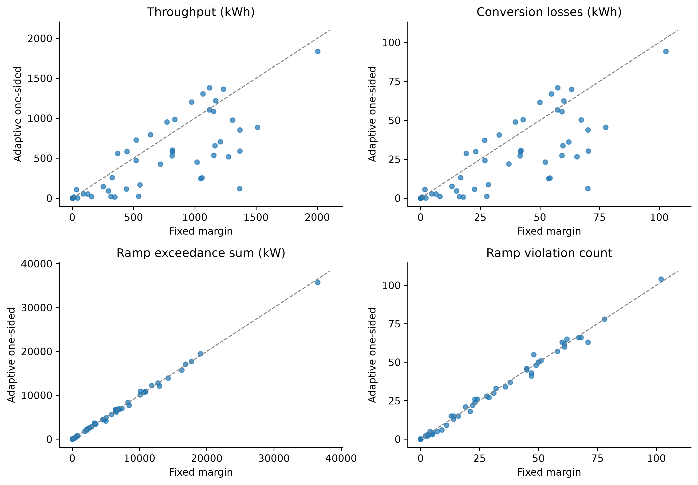
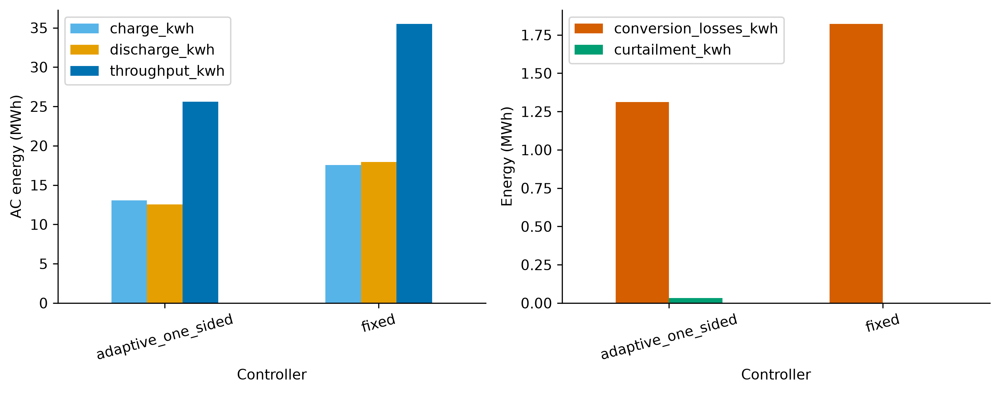
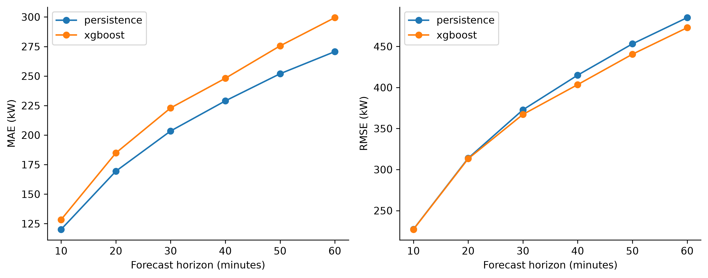
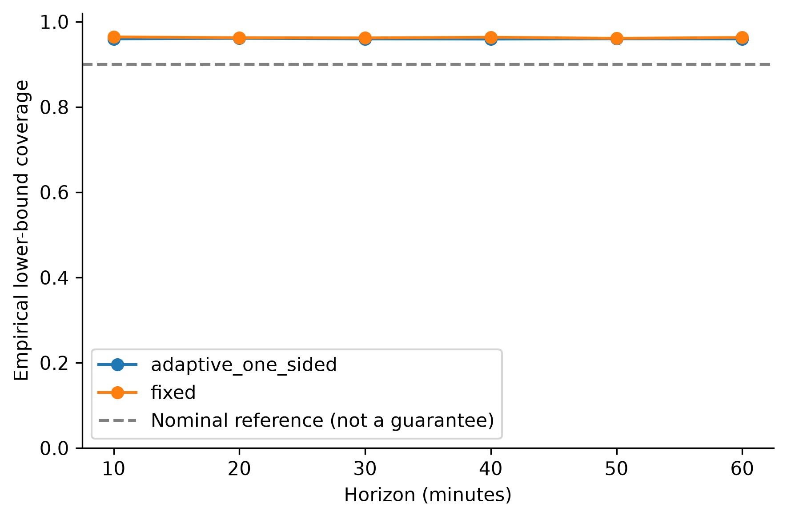
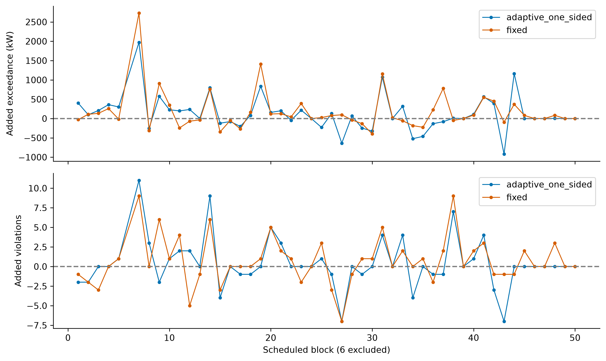
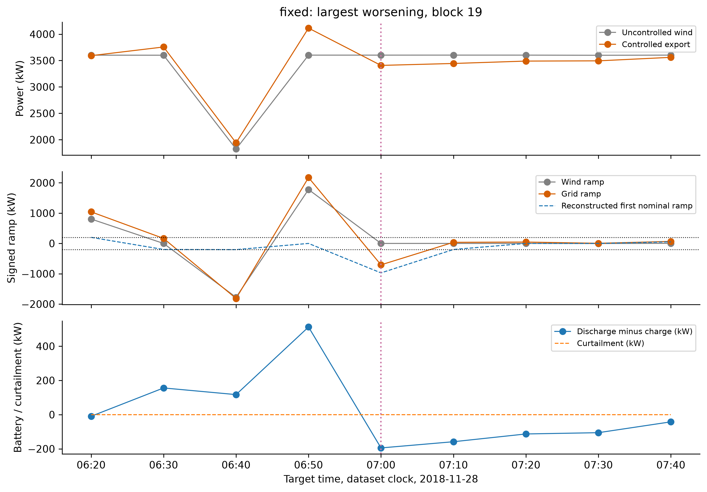
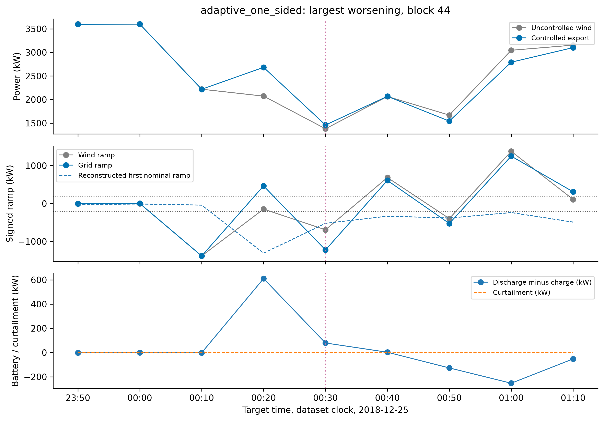
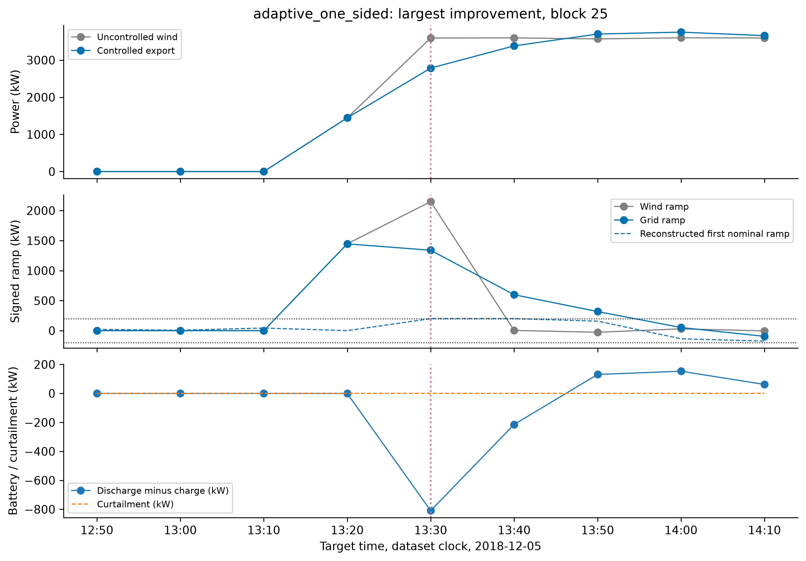
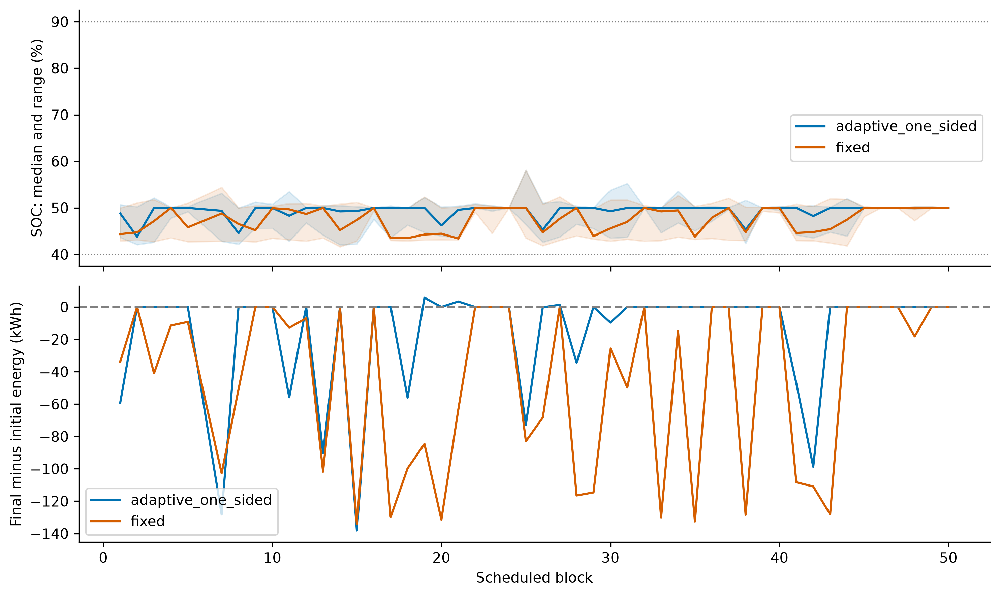

# Wind–battery predictive control with causal one-sided uncertainty: a retrospective comparison and diagnosis of realised ramp deterioration

**Raja Arqam Abdullah** — MSc Artificial Intelligence, Teesside University

Supervisor-review submission draft, 29 October 2026. No journal submission or external publication has occurred. The archived experiment and its numerical results are unchanged.

## Abstract

Forecast-informed battery dispatch can reduce predicted wind-power fluctuations without improving realised grid ramps. This study evaluates six direct XGBoost wind forecasts at 10–60-minute horizons and compares frozen fixed-margin and rolling one-sided uncertainty configurations within mixed-integer model predictive control (MPC). Residual targets are eligible only when strictly earlier than the decision. Two objective-priority solves minimise predicted ramp exceedance and then operational penalties subject to a frozen 100 kW primary allowance. Forty-nine scheduled episodes yield 7,056 controlled ten-minute intervals per controller; development block 6 is excluded. However, earlier evaluation-period inspection and five block-7 target times shared with development prevent an untouched confirmatory interpretation. Adaptive one-sided MPC reduces battery throughput by 27.86%, modelled conversion losses by 27.92%, summed exceedance by 0.77%, and violations by 16 relative to fixed margins. Both controllers nevertheless exceed uncontrolled wind in violation count: 1,502 fixed and 1,486 adaptive versus 1,465 uncontrolled. Summed exceedance is 326,158.296, 323,638.526 and 317,210.288 kW, respectively. Trace-level attribution shows that changing battery injection introduces more threshold violations than it removes. Both controllers reduce the maximum ramp but increase the mean absolute ramp. XGBoost improves RMSE while worsening MAE relative to persistence. The results support a reproducible retrospective comparison and failure diagnosis, not guaranteed coverage, net aggregate ramp mitigation, extended battery lifetime or universal controller superiority.

**Keywords:** wind-power forecasting; XGBoost; causal uncertainty; one-sided residual calibration; battery storage; mixed-integer MPC; lexicographic optimisation with tolerance; ramp exceedance.

## 1. Introduction and research gap

Short-horizon wind forecasts can inform battery dispatch, yet point-forecast accuracy and predicted control cost do not establish realised operational benefit. A controller can alter stored-energy inventory, conversion losses and export ramps in different directions. An empirical assessment therefore needs an uncontrolled reference, explicit battery accounting and separate treatment of violation frequency and exceedance magnitude.

Forecast-driven wind–battery MPC and probabilistic dispatch are established [R09–R11]. Conformal and asymmetric renewable forecasts are also established [R03–R08]. The research gap considered here is consequently not the invention of those components. It is the reproducible evaluation of a particular frozen integration, including strict residual timing, mixed-integer physical execution, a development-selected uncertainty policy and an explicit diagnosis when realised aggregate ramp outcomes worsen. Publication value rests on transparent implementation and evidence, including negative findings; a first-ever combination is not asserted.

## 2. Related work

Chen and Guestrin introduced the scalable XGBoost framework [R01], and wind applications such as TS_XGB demonstrate that using boosted trees for short-horizon power forecasting is not itself novel [R02]. Split-conformal regression supplies a model-agnostic calibration framework under its sampling assumptions [R03]. Nonexchangeable extensions and adaptive conformal inference address different forms of drift using specified procedures [R04,R05]. Their guarantees do not automatically apply to a fixed-alpha rolling window with static floors.

Conformal temporal-convolutional wind intervals [R06], asymmetric multi-quantile wind prediction [R07] and conformal PV calibration [R08] precede the present implementation. They motivate reporting empirical calibration and sharpness rather than treating a nominal level as proof of reliability. This work implements a simpler signed lower-margin construction and evaluates downstream control rather than a new interval-prediction architecture.

Constrained battery MPC for smoothing [R09], non-Gaussian stochastic wind–battery MPC [R10] and forecast-informed wind-gradient control [R11] establish the main control context. Lexicographic storage control has also prioritised operating-limit violations over storage losses in a different application [R12]. Wind-fluctuation MPC and filtering alternatives provide additional relevant baselines [R13], but this study does not claim superiority to those implementations. Battery-model reviews and cycle-aging control studies show why fixed-efficiency throughput is not a degradation or lifetime model [R14,R15]. A detailed, source-linked comparison of all fifteen papers is provided in [literature_review.md](literature_review.md). Full-text and bibliographic access limitations are retained there.

## 3. Research contributions and scope

The contributions are: (i) an executable six-horizon uncertainty/control integration with strict target-time eligibility and preserved first-command physical semantics; (ii) paired trace-level accounting of throughput, conversion losses, curtailment, actual export and terminal inventory; and (iii) a reproducible diagnostic separating forecast mismatch, injection changes, objective trade-offs and unidentifiable mechanisms when control worsens aggregate ramps. These are empirical engineering contributions. The study neither supplies a conformal theorem nor isolates the causal effect of adaptation alone, since score direction, static floors and updating rules change together.

## 4. Data and forecasting methodology

The local source is the 2018 turbine SCADA file `T1.csv`, containing timestamps, active power, wind speed, wind direction and a theoretical power curve. Dataset attribution is the [Wind Turbine SCADA Dataset](https://www.kaggle.com/datasets/berkerisen/wind-turbine-scada-dataset). Exact download version, measurement aggregation convention, timezone and redistribution rights require author verification. Negative power is clipped to zero for physical generation/target simulation. Contiguous episodes retain ten-minute observations; gaps and incomplete episode tails are not filled.

Fourteen current/past features comprise power, wind speed and direction; timestamp-based 10/20/30/60-minute power and wind-speed lags; ten-minute power/wind changes; and the mean of current/10/20/30-minute power. Six separately fitted XGBoost models predict the next 10–60 minutes. Historical settings are 300 estimators, depth 4, learning rate 0.05, subsample 0.8, column subsample 0.9, squared-error objective and seed 42. Training retains 60-minute targets strictly before 9 September 2018 02:50. Validation origins begin at that boundary with last targets strictly before 5 November 2018 15:10. No model is fitted or selected during the present evaluation.

The evaluation reuses stored predictions. Independent audit inference with the existing models agrees within 0.000122 kW, consistent with stored numeric precision; raw feature lookup matches current/past measurements. This establishes current artifact consistency, not independently attested provenance of the historical training run. Persistence repeats nonnegative current power at every horizon.

## 5. Causal uncertainty estimation

For origin (a) and horizon (h), the score is (r_{a,h}=hat w_{a,h}-w_{a+hDelta}). At decision (t), only (a+hDelta<t) is eligible. The newest 144 eligible scores form the rolling window; targets equal to the decision are excluded. The finite-sample rank is (lceil145(1-0.10)
ceil=131), without interpolation. The adaptive margin is the larger of this signed order statistic and a frozen horizon-specific floor, except for the inherited post-gap fallback rule. The rule uses the floor until 72 selected origins follow 31 October 2018 16:50.

Adaptive floors range from 358.380 to 731.662 kW; fixed absolute-error calibration margins range from 400.014 to 786.613 kW. The complete six-vectors and exact rule appear in Appendix A. The calibration file's latest 60-minute target is 15 October 2018 11:50, before the first scheduled evaluation decision. The adaptive floor values are legacy constants whose derivation is not reproduced by the current calibration file's signed 90th percentiles; no new derivation or calibration claim is invented.

The nominal path is the nonnegative forecast; the downside path is (max(0,hat w-m)). All scheduled observations can be stored in memory, but the strict target filter determines eligibility. Already observed block-6 residuals may enter later windows even though block 6 is not scored. History carries across battery episode resets. The method is rolling conformal-style score calibration with fixed alpha, not the adaptive-alpha algorithm of [R05]. Serial dependence, floors and fallback prevent an asserted distribution-free or joint six-horizon coverage guarantee.

## 6. Battery and scenario model

The battery has 2,000 kWh capacity, 1,000 kW charge/discharge ratings, 800–1,800 kWh stored-energy bounds and 0.95 charging/discharging efficiencies. Decisions use a six-interval horizon with (Delta=1/6) hour. For scenario (s), export and energy satisfy

[
g_{s,k}=w_{s,k}-u_{s,k}-c_{s,k}+d_{s,k},qquad
E_{s,k+1}=E_{s,k}+eta_c c_{s,k}Delta-d_{s,k}Delta/eta_d.
]

Binary modes prohibit simultaneous charging/discharging. Charging uses available wind only, curtailment cannot exceed remaining wind, export is nonnegative, and all planned energy states remain within hard SOC bounds. No additional grid-export cap, grid charging or hard 1,000 kWh reserve is implemented. The reserve is a soft objective target, distinct from the 800 kWh hard lower bound.

Nominal/downside paths receive equal weights. Requested first charge, discharge, curtailment and mode are common; realised first scenario charge and curtailment are exact wind-limited minima implemented with binary selectors. Subsequent planned actions are scenario dependent. This scenario-fan recourse approximation does not constitute a general multistage information tree. Actual h1 generation is accessed only after both optimisation solves commit their requests. The physical simulation applies power, wind-availability and SOC caps before updating actual export and energy.

## 7. Objective priorities and computational settings

The first mixed-integer solve minimises weighted six-step predicted exceedance,

[
J_1^*=minsum_spi_ssum_k e_{s,k},qquad
e_{s,k}ge |g_{s,k}-g_{s,k-1}|-200,quad e_{s,k}ge0.
]

The second solve restricts (J_1le J_1^*+100), then minimises absolute grid ramps, battery-power changes, exceedance, throughput, terminal-energy deviation, curtailment and reserve shortfall. The respective frozen coefficients are 1, 0.1, 20, (0.1Delta), 2, 50 and 100. The terminal and reserve energy references are both 1,000 kWh. Absolute values use linear epigraphs. The mixed-unit weights are not financial prices.

The 100 kW allowance applies to the weighted sum across the horizon, not independently to each interval and not to actual realised ramps. This is lexicographic optimisation with tolerance, not strict primary preservation. Both CVXPY solves call HiGHS and require `optimal` status; an additional guard checks achieved primary cost within the allowance plus 0.001. No explicit thread, seed, time-limit or MIP-gap override is supplied. The recorded environment uses Python 3.12.5, CVXPY 1.9.3 and highspy 1.15.1. Original CSVs omit full planned trajectories, stage costs, optimality gaps and per-decision solve times, limiting retrospective optimisation-certificate and runtime claims. Appendix A specifies all implemented equations, including Big-M selectors and execution caps.

## 8. Experimental design and information limitations

Audited validation predictions were split chronologically into calibration and controller development; eighteen complete development episodes informed the frozen preference for adaptive one-sided MPC. The development comparison showed 43.70% lower throughput, approximately 43.75% lower modelled conversion losses and 0.66% lower exceedance, but eleven more violations (710 versus 699). These were development observations, not confirmatory estimates.

The preserved evaluation schedule identifies fifty complete episodes and explicitly labels block 6 development. The archived scores retain the other 49 episodes, 144 ten-minute intervals each, from November–December 2018. Every episode starts with 1,000 kWh, zero previous battery injection and initial export equal to current nonnegative wind. There are 144 scored transitions, including the initial origin-to-first-output transition, and no cross-episode transition. Both controllers use identical inputs, initial conditions, physical constraints, coefficients and solver interface.

Two qualifications preclude a clean confirmatory holdout interpretation. First, repository history contains evaluation-period event investigations before the freeze. Second, block 6's last development origin is 15 November 2018 12:50 and its six-horizon targets extend to 13:50. Block 7 starts at 13:00; measured target times 13:10–13:50 are shared, comprising fifteen horizon-target pairs and five scored h1 outcomes. The old preflight checks only the eighteen earlier development files and misses this schedule-designated development overlap. Excluding block 6 alone therefore does not establish target-disjoint development/testing. The current package discloses this problem without silently altering the scored set or replacing official totals.

## 9. Mathematical methodology and scoring

Appendix A gives the complete source-matched formulation: notation, forecasting, causal eligibility/order statistic, scenario paths, binary operating modes, first-command minimum selectors, soft reserve, two optimisation priorities, execution and terminal accounting. No unimplemented constraint is added.

A violation is an absolute ten-minute grid change greater than 200.001 kW. Summed exceedance is (sum_imax(0,|g_i-g_{i-1}|-200)), with units kW, not energy. The uncontrolled baseline uses the same target wind, episode boundary and transition count. Mean and maximum ramps are separate metrics.

AC-side throughput is (Deltasum(c+d)). Losses equal (0.05Q_c+(1/0.95-1)Q_d). Energy conservation is checked as wind = actual export + curtailment + conversion loss + stored-inventory change. Terminal adjustment adds (0.95delta E) for surplus or (delta E/0.95) for deficit relative to the initial 1,000 kWh. It is hypothetical inventory restoration, not additional realised export, a feasible future dispatch or revenue.

All differences pair adaptive and fixed within the same episode. Existing 10,000-draw day-bootstrap intervals are retained only as descriptive IID-day resampling outputs; they do not accommodate serial dependence. The new analysis reports within-segment lag correlations and segment totals without changing the bootstrap estimator, tuning block lengths, assigning p-values or selecting controllers. Seven thousand intervals and forty-two thousand horizon comparisons are dependent observations, not independent replications.

## 10. Results

### 10.1 Controller outcomes and the uncontrolled reference

**Table 1.** Original aggregate outcomes on identical 7,056 transitions. Battery energies are AC-side; no-battery throughput/losses are zero.

| Strategy | Violations | Exceedance sum (kW) | Throughput (MWh AC) | Conversion losses (MWh) |
| --- | --- | --- | --- | --- |
| Uncontrolled wind | 1465 | 317,210.288 | 0.000 | 0.000 |
| Fixed-margin MPC | 1502 | 326,158.296 | 35.487 | 1.822 |
| Adaptive one-sided MPC | 1486 | 323,638.526 | 25.599 | 1.313 |

Adaptive reduces throughput by 27.8644%, modelled conversion losses by 27.9249%, exceedance by 0.7726% and violations by sixteen relative to fixed margins. Nevertheless, fixed and adaptive exceed uncontrolled summed exceedance by 2.82% and 2.03%, respectively, with 37 and 21 more violations. Mean absolute ramp rises from 120.122 kW uncontrolled to 124.344 fixed and 123.654 adaptive. Maximum ramp improves from 2,318.176 kW uncontrolled to 2,174.275 fixed and 2,132.655 adaptive. Thus the direction of benefit depends on the ramp outcome.

### 10.2 Battery use and inventory

**Table 2.** Actual and hypothetical adjusted export, curtailment and inventory. Negative inventory indicates depletion of the episode's initial energy.

| Controller | Actual export (MWh) | Adjusted export (MWh) | Curtailment (MWh) | Stored inventory change (MWh) |
| --- | --- | --- | --- | --- |
| fixed | 1,801.383303 | 1,799.021589 | 0.000000 | -2.243625 |
| adaptive_one_sided | 1,800.395602 | 1,799.572818 | 0.033385 | -0.780632 |

Adaptive exports 0.987701 MWh less in the physical simulation but has 0.551229 MWh more hypothetical adjusted export. Fixed also consumes more initial stored inventory, explaining why actual export alone does not identify improved wind capture. Neither terminal adjustment nor throughput establishes battery lifetime benefit.

### 10.3 Forecast accuracy and lower-bound coverage

**Table 3.** Point-forecast errors over the same retained origins at each horizon.

| Horizon (min) | XGBoost MAE (kW) | Persistence MAE (kW) | XGBoost RMSE (kW) | Persistence RMSE (kW) |
| --- | --- | --- | --- | --- |
| 10 | 128.388 | 120.122 | 227.070 | 227.234 |
| 20 | 184.849 | 169.411 | 313.187 | 313.811 |
| 30 | 222.971 | 203.445 | 367.173 | 372.805 |
| 40 | 248.113 | 228.966 | 403.508 | 415.037 |
| 50 | 275.550 | 251.946 | 440.551 | 453.165 |
| 60 | 299.455 | 270.685 | 472.869 | 485.127 |

XGBoost has higher MAE but lower RMSE at every horizon; its predictive benefit is not uniform across error metrics. **Table 4** reports empirical marginal lower-bound coverage, without a conditional, simultaneous or distribution-free guarantee.

| Horizon (min) | Fixed lower coverage (%) | Adaptive lower coverage (%) |
| --- | --- | --- |
| 10 | 96.43 | 95.98 |
| 20 | 96.24 | 96.10 |
| 30 | 96.20 | 95.96 |
| 40 | 96.36 | 95.92 |
| 50 | 96.10 | 95.99 |
| 60 | 96.30 | 95.96 |

Adaptive margins equal their static floors in approximately 86–88% of decisions at each horizon, and none of the evaluated fallback flags is active. The comparison therefore cannot attribute gains specifically to rolling updating or gap fallback.

### 10.4 Block differences and temporal dependence

Exceedance improves in 22 blocks, worsens in 21 and ties in six; the median paired difference is zero. Violation counts improve in 21, worsen in 14 and tie in 14. Throughput decreases in 32 blocks, increases in twelve and ties in five. The existing descriptive resampling bounds for mean paired exceedance are -140.935 to +33.772 kW/block and for violation count -0.980 to +0.286 per block; both span zero and neither is a dependence-adjusted confidence interval for the headline percentage or count difference.

**Table 5.** Chronological segment totals, adaptive minus fixed. These four segments are not assured independent replications.

| segment_id | blocks | exceedance_difference_kw | violations_difference | throughput_difference_kwh |
| --- | --- | --- | --- | --- |
| 1 | 5 | 908.152 | 2 | -1,853.325 |
| 2 | 18 | -872.671 | 4 | -2,784.760 |
| 3 | 12 | -1,534.399 | -5 | -2,740.476 |
| 4 | 14 | -1,020.852 | -17 | -2,509.660 |

Within-segment lag-one correlation of paired exceedance differences is -0.201 using 45 adjacent-day pairs. Other outcomes/lags and the limited pair counts appear in the diagnostic tables; this is descriptive dependence investigation, not validation of an IID resampling model. Development and evaluation also show different relative throughput reductions (43.70% versus 27.86%) and opposite violation-count directions. Unequal exposure and weather prevent raw cross-period totals from identifying distribution-shift effects.

## 11. Diagnostic of realised ramp deterioration

For net battery injection (b=d-c), define total controlled injection (j=b-u). Every stored transition satisfies the identity

[
Delta g_i=Delta w_i+Delta j_i,qquad j_0=0 	ext{at episode initialisation}.
]

Here the zero refers to the pre-first-output injection, not the first controlled output. Injection changes can cancel or reinforce wind changes. Fixed introduces 166 threshold violations absent in uncontrolled wind and removes 129, giving net +37. Adaptive introduces 134 and removes 113, giving net +21. Gross added versus removed exceedance is 40,241.350 versus 31,293.343 kW for fixed and 33,187.114 versus 26,758.877 kW for adaptive. Identical timestamps, transition counts and initial references rule out a ramp-accounting mismatch as the explanation in these checks.

The deliberately selected largest fixed deterioration is block 19 at 28 November 2018 07:00: a +0.095 kW wind change becomes a -706.980 kW grid change while net injection changes from +512.363 to -194.712 kW. Adaptive's largest deterioration is block 44 at 25 December 2018 00:30: a -692.038 kW wind change combines with a -531.450 kW injection change. The largest improvement for both occurs in block 25 at 5 December 2018 13:30, where charging of approximately 809.46 kW reduces a +2,148.607 kW wind ramp to approximately +1,339.15 kW. These are labelled diagnostic extremes, not representative independent estimates or favourable controller-selection examples.

Saved requests and forecast paths permit reconstruction of first-step scenario exports relative to actual previous controlled export. Both first scenarios predict a safe ramp yet an actual violation occurs in 38 fixed and 59 adaptive intervals. This is evidence of scenario/realisation mismatch, not recovery of the unavailable six-step stage objectives. No discharge safety clipping is observed; realised charging is below requested charging in 152 fixed and 85 adaptive intervals. Neither trajectory reaches a hard SOC bound within 0.01 kWh. End-of-interval energy is below the 1,000 kWh soft reserve in 4,186 fixed and 2,281 adaptive intervals.

The code confirms expected trade-offs: forecast-based rather than actual-ramp optimisation, a 100 kW aggregate primary allowance, battery-ramp regularisation, terminal/reference penalties and strongly weighted reserve shortfall. These design properties can affect dispatch, but existing traces cannot identify their separate causal contributions. Claims that the reserve weight or allowance specifically caused the deterioration remain hypotheses requiring a new predeclared experiment. No serious physical-balance or transition-counting implementation error was found by the diagnostic. The confirmed overlap/pre-freeze exposure is instead a scientific-design limitation.

## 12. Discussion

The strongest supported operational result is reduced battery activity and modelled conversion loss relative to another frozen battery controller. The aggregate ramp change is small and heterogeneous. More importantly, both battery controllers worsen count, summed exceedance and mean absolute ramp versus no battery, despite reducing the maximum ramp. A general claim of improved grid stability or net aggregate ramp mitigation would therefore contradict the present evidence.

The negative outcome is consistent with the distinction between planned scenarios and realised wind. Scenario-fan recourse, downwards-only uncertainty paths, a six-step horizon and episode inventory resets can favour actions that are locally plausible in the planning model but create actual injection reversals. These are explanations of possible mechanisms, not experimentally separated effects. The exact injection identity establishes what happened in each realised transition; only controlled, development-designed ablations or genuinely new evaluation data could establish why a particular objective design is preferable.

The comparison is mechanically paired and preserves development selection. It nevertheless bundles score direction, static margins and window updating, so it is not an isolated treatment effect of adaptation. High empirical lower coverage, frequent floor activation and worse MAE than persistence further argue against a simple narrative of more accurate AI forecasts producing universally better control.

## 13. Limitations

The single-turbine, limited-season record, omitted gaps and complete-episode sampling constrain generalisation. Historic model-training provenance cannot be independently certified from source alone. Prior evaluation inspection and development-target overlap invalidate untouched confirmatory language; removing a few targets now would not erase historical exposure. Ordinary day resampling does not correct chronology. The battery is fixed-efficiency and omits temperature, degradation, auxiliary consumption, self-discharge and state-estimation error. Its daily resets and hypothetical terminal restoration do not represent continuous annual operation. Two scenarios do not model a verified joint distribution, recourse is approximate, and soft ramps offer no grid-code or network-flow guarantee. Solver success offline does not establish embedded real-time feasibility. Missing stage trajectories, gaps and timing constrain causal attribution and computational claims. Adaptive floor provenance, exact dataset licence/version and some final bibliographic export details remain author-review items. See [unresolved_scientific_issues.md](unresolved_scientific_issues.md).

## 14. Conclusion

A frozen adaptive one-sided uncertainty configuration uses less battery throughput and incurs fewer modelled conversion losses than the fixed-margin configuration while slightly reducing their aggregate exceedance and violation count. This relative result survives independent trace recomputation and a first-block solver replay. It does not establish untouched generalisation or net ramp mitigation relative to uncontrolled wind: both controllers worsen aggregate exceedance and violations, although the maximum ramp decreases. The study's defensible contribution is an auditable retrospective comparison, explicit inventory accounting and a reproducible negative-outcome diagnostic. Any redesigned controller or revised confirmatory evaluation requires a new freeze and appropriate independent data.

## 15. Reproducibility, software and data availability

The frozen development manifest SHA256 is `b007aa5c57b5610ea75663d592b92816598c15658ed21bf0fcd99c107859895a`. Frozen sources, models, calibration, datasets, original results and earlier paper/results drafts are preserved. The local audit reconstructs all 42,336 decision/horizon margins and verifies 42,336 raw-target comparisons and 98 physical traces. Existing eight tests and additional dashboard/diagnostic tests are described in the verification report; there is no claim of an independent-personnel or full-platform replication.

The implementation uses CVXPY ([Diamond and Boyd, 2016](https://www.jmlr.org/papers/v17/15-408.html)) and HiGHS ([official solver/citation record](https://highs.dev/)); their software references supplement the fifteen domain/method references below. The local Streamlit app displays historical replay, not a live wind-farm interface. Optional new-directory replay invokes the existing frozen controller runner without parameter changes. Setup, file requirements, limitations and commands appear in [reproducibility.md](reproducibility.md).

Datasets, models and full traces are local ignored artifacts; a fresh clone alone cannot reproduce numerical control results. Summary tables and figures accompany the draft. Before public release the author must establish a permitted versioned artifact-access route, dataset attribution/redistribution terms and project licensing. No data repository DOI or journal acceptance is asserted. Source code and prose should receive author/supervisor review, including institutional requirements for disclosure of computational and AI assistance. The paper has not been submitted or published by this task.

## 16. Verified references

Reference identifiers R01–R15 correspond to the source-linked comparison in `literature_review.md`. Verification used publisher, author or institutional primary records; limitations remain explicit rather than inventing metadata or DOIs.

**[R01]** Chen, T., and Guestrin, C. (2016). **XGBoost: A Scalable Tree Boosting System.** Proceedings of the 22nd ACM SIGKDD International Conference on Knowledge Discovery and Data Mining, 785–794. [Published DOI: 10.1145/2939672.2939785](https://doi.org/10.1145/2939672.2939785). [Author manuscript and published-DOI record](https://arxiv.org/abs/1603.02754).

**[R02]** Jiang, J., Wang, F., Tang, R., Zhang, L., and Xu, X. (2022). **TS_XGB: Ultra-Short-Term Wind Power Forecasting Method Based on Fusion of Time-Spatial Data and XGBoost Algorithm.** Procedia Computer Science, 199, 1103–1111 (ITQM conference proceedings). [Published DOI: 10.1016/j.procs.2022.01.140](https://doi.org/10.1016/j.procs.2022.01.140). [Publisher record](https://www.sciencedirect.com/science/article/pii/S1877050922001417). [Official ITQM 2020/2021 programme, corroborating author set and conference context](https://www.hse.ru/data/2021/08/25/1414853066/ITQM%20Program.pdf). The programme and final indexed article use different author ordering; the bibliography here follows the final article's Jiang-first record, corroborated in published citations. Full publisher PDF access was restricted during verification; no unobserved implementation detail is asserted.

**[R03]** Lei, J., G'Sell, M., Rinaldo, A., Tibshirani, R. J., and Wasserman, L. (2018). **Distribution-Free Predictive Inference for Regression.** Journal of the American Statistical Association, 113(523), 1094–1111. [Published DOI: 10.1080/01621459.2017.1307116](https://doi.org/10.1080/01621459.2017.1307116). [Author-hosted published article](https://www.stat.cmu.edu/~ryantibs/papers/conformal-jasa.pdf). Online-first records can show 2017; 2018 is the journal-issue year.

**[R04]** Barber, R. F., Candès, E. J., Ramdas, A., and Tibshirani, R. J. (2023). **Conformal prediction beyond exchangeability.** The Annals of Statistics, 51(2), 816–845. [Published DOI: 10.1214/23-AOS2276](https://doi.org/10.1214/23-AOS2276). [Publisher article](https://projecteuclid.org/journals/annals-of-statistics/volume-51/issue-2/Conformal-prediction-beyond-exchangeability/10.1214/23-AOS2276.pdf).

**[R05]** Gibbs, I., and Candès, E. (2021). **Adaptive Conformal Inference Under Distribution Shift.** Advances in Neural Information Processing Systems, 34. [Official peer-reviewed proceedings record and paper](https://papers.nips.cc/paper/2021/hash/0d441de75945e5acbc865406fc9a2559-Abstract.html). No proceedings DOI identified. The arXiv DOI identifies a preprint and is intentionally not presented as the published DOI.

**[R06]** Hu, J., Luo, Q., Tang, J., Heng, J., and Deng, Y. (2022). **Conformalized temporal convolutional quantile regression networks for wind power interval forecasting.** Energy, 248, 123497. [Published DOI and publisher record: 10.1016/j.energy.2022.123497](https://doi.org/10.1016/j.energy.2022.123497). Author roles are visible in the publisher's credit statement; the abstract and experimental description support the comparison above.

**[R07]** Wang, W., Feng, B., Huang, G., Guo, C., Liao, W., and Chen, Z. (2023). **Conformal asymmetric multi-quantile generative transformer for day-ahead wind power interval prediction.** Applied Energy, 333, 120634. [Published DOI: 10.1016/j.apenergy.2022.120634](https://doi.org/10.1016/j.apenergy.2022.120634). [Author-institution metadata](https://vbn.aau.dk/en/publications/conformal-asymmetric-multi-quantile-generative-transformer-for-da/), [publisher abstract/method record](https://www.sciencedirect.com/science/article/abs/pii/S0306261922018918). The DOI contains 2022; the journal issue is 2023.

**[R08]** Renkema, Y., Visser, L., and AlSkaif, T. (2024). **Enhancing the reliability of probabilistic PV power forecasts using conformal prediction.** Solar Energy Advances, 4, 100059. [Published DOI: 10.1016/j.seja.2024.100059](https://doi.org/10.1016/j.seja.2024.100059). [Author-institution published PDF](https://dbc.library.uu.nl/bitstream/handle/1874/451621/1-s2.0-S2667113124000093-main.pdf?isAllowed=y&sequence=1), [publisher record](https://www.sciencedirect.com/science/article/pii/S2667113124000093).

**[R09]** Khalid, M., and Savkin, A. V. (2010). **A model predictive control approach to the problem of wind power smoothing with controlled battery storage.** Renewable Energy, 35(7), 1520–1526. [Published DOI: 10.1016/j.renene.2009.11.030](https://doi.org/10.1016/j.renene.2009.11.030). [Author-institution record](https://pure.kfupm.edu.sa/en/publications/a-model-predictive-control-approach-to-the-problem-of-wind-power-/). The DOI contains 2009; the issue is July 2010.

**[R10]** Kou, P., Gao, F., and Guan, X. (2015). **Stochastic predictive control of battery energy storage for wind farm dispatching: Using probabilistic wind power forecasts.** Renewable Energy, 80, 286–300. [Published DOI: 10.1016/j.renene.2015.02.001](https://doi.org/10.1016/j.renene.2015.02.001). [Publisher record](https://www.sciencedirect.com/science/article/pii/S0960148115000919). The retrieved publisher abstract supports chance constraints, non-Gaussian forecasts and constrained BESS dispatch; it does not establish applicability to this project's exact ramp objective.

**[R11]** Hovgaard, T. G., Boyd, S., and Jørgensen, J. B. (2015). **Model predictive control for wind power gradients.** Wind Energy, 18(6), 991–1006. [Published DOI: 10.1002/we.1742](https://doi.org/10.1002/we.1742). [Author-institution record](https://orbit.dtu.dk/en/publications/model-predictive-control-for-wind-power-gradients/), [author manuscript](https://stanford.edu/~boyd/papers/pdf/wind_gradients_cvx.pdf). Do not confuse this three-author journal article with the four-author 2013 ECC paper of a related title.

**[R12]** Tziovani, L., Hadjidemetriou, L., Charalampous, C., Tziakouri, M., Timotheou, S., and Kyriakides, E. (2021). **Energy Management and Control of a Flywheel Storage System for Peak Shaving Applications.** IEEE Transactions on Smart Grid, 12(5), 4195–4207. [Published DOI: 10.1109/TSG.2021.3084814](https://doi.org/10.1109/TSG.2021.3084814). [Author-deposited published-version record](https://zenodo.org/records/4888894), [European Commission OneNet project publication record](https://cordis.europa.eu/project/id/957739/results). The author deposit establishes the method and author set; the project's official funder record independently confirms the final 2021 volume/issue, pages, full author order and DOI. The Crossref API and direct IEEE export were inaccessible to this browsing tool; those failures are not represented as successful verification.

**[R13]** Sun, Y., Tang, X., Sun, X., Jia, D., Cao, Z., Pan, J., and Xu, B. (2019). **Model predictive control and improved low-pass filtering strategies based on wind power fluctuation mitigation.** Journal of Modern Power Systems and Clean Energy, 7, 512–524. [Published DOI and publisher record: 10.1007/s40565-018-0474-5](https://doi.org/10.1007/s40565-018-0474-5). Online publication was 26 December 2018; 2019 is the issue year.

**[R14]** Rosewater, D. M., Copp, D. A., Nguyen, T. A., Byrne, R. H., and Santoso, S. (2019). **Battery Energy Storage Models for Optimal Control.** IEEE Access, 7, 178357–178391. [Published DOI: 10.1109/ACCESS.2019.2957698](https://doi.org/10.1109/ACCESS.2019.2957698). [Author's Sandia dissertation, identifying the article and its model-review contribution](https://www.sandia.gov/ess-ssl/wp-content/uploads/2020/09/DM_Rosewater_Dissertation.pdf), [author laboratory publication record](https://energy.sandia.gov/staff/ray-byrne/). The IEEE DOI endpoint was not fully accessible to the browsing tool; the primary author/laboratory records corroborate the publication.

**[R15]** Shi, Y., Xu, B., Tan, Y., Kirschen, D. S., and Zhang, B. (2019). **Optimal Battery Control Under Cycle Aging Mechanisms in Pay for Performance Settings.** IEEE Transactions on Automatic Control, 64(6), 2324–2339. [Published DOI: 10.1109/TAC.2018.2867507](https://doi.org/10.1109/TAC.2018.2867507). [Author manuscript and publication-status record](https://arxiv.org/abs/1709.05715), [IEEE Control Systems Society's 2019 journal index](https://ieeecss.org/sites/ieeecss/files/2020-08/Index_2019.pdf), [author implementation](https://github.com/Yuanyuan-Shi/Cycle-based-Battery-Controller). The manuscript appeared earlier online; 2019 is the volume year.

## Appendix A. Complete source-matched mathematical formulation

This appendix specifies the implemented controllers, not a redesigned controller. Equations correspond to `scripts/frozen_fixed_heldout.py`, `scripts/frozen_adaptive_one_sided_heldout.py` and the hash-verified uncertainty module. The archived 49-block results are retrospective: pre-freeze test-period access and development block 6's overlap with block 7 preclude an untouched confirmatory-test interpretation.

### 1. Time, notation and assumptions

Let a decision origin be \(t\), the interval length \(\Delta=1/6\) hour, and the horizon \(H=6\). Forecast index \(h=1,\ldots,6\) targets \(t+h\Delta\); optimisation index \(k=0,\ldots,5\) corresponds to \(h=k+1\). All timestamps use the dataset's unconfirmed, timezone-naive clock. The simulator treats each target power sample as the representative power for the ten-minute control interval ending at that target; continuous intra-interval dynamics are not modelled.

| Symbol | Definition / frozen value |
| --- | --- |
| \(y_t,w_t\) | Measured power, and its nonnegative simulation value \(w_t=\max(0,y_t)\), kW |
| \(\hat w_{t,h}\) | Nonnegative XGBoost forecast, kW |
| \(E_t\) | Battery stored energy at the decision, kWh |
| \(g_t^-,b_t^-\) | Previous realised grid export and net battery injection, kW |
| \(c,d,u,g\) | Charge, discharge, curtailment and grid-export power, kW |
| \(b=d-c\) | Net battery injection, kW |
| \(C,P\) | Battery capacity 2,000 kWh; charge/discharge rating 1,000 kW |
| \(E_{\min},E_{\max}\) | 800 and 1,800 kWh; SOC bounds 40–90% |
| \(E_{\rm ref},E_{\rm res}\) | Terminal reference and soft reserve target, both 1,000 kWh |
| \(\eta_c,\eta_d\) | Charge and discharge efficiency, both 0.95 |
| \(R,\varepsilon\) | Ramp threshold 200 kW; aggregate primary allowance 100 kW |
| \(s,\pi_s\) | Nominal/downside scenario, each with weight 0.5 |

Episodes start with \(E_t=1000\), \(b_t^-=0\) and \(g_t^-=\max(0,y_t)\). Later decisions use the preceding actual export and battery injection. Battery state resets between episodes; uncertainty history does not. The reset does not simulate replenishment between consecutive episodes. A 200 kW change over ten minutes corresponds to 20 kW/min; the implementation penalises power differences, not a time-normalised ramp derivative.

### 2. Multi-horizon forecasts

Six separately fitted historical regressors supply

\[
\hat w_{t,h}=\max\{0,f_h(x_t)\},\qquad
f_h(x)=b_h+\sum_{m=1}^{300}T_{h,m}(x),\quad h=1,\ldots,6.
\tag{1}
\]

Here \(b_h\) denotes the fitted base score and \(T_{h,m}\) the stored tree contribution including shrinkage; this is a representation of the fitted predictor, not a new training objective. Inputs are current power, wind speed/direction, timestamp-joined 10/20/30/60-minute power and wind-speed lags, ten-minute power/wind changes and the mean of current/10/20/30-minute power. Historical settings are depth 4, learning rate 0.05, subsample 0.8, column subsample 0.9, squared-error objective and seed 42. The historical training script keeps 60-minute targets strictly before 9 September 2018 02:50. Current control evaluation reads stored predictions and never fits \(f_h\). Persistence is \(\max(0,y_t)\) at every horizon.

### 3. Causal one-sided uncertainty

For forecast origin \(a\), define the signed overprediction residual

\[
r_{a,h}=\hat w_{a,h}-\max(0,y_{a+h\Delta}),\qquad
\mathcal I_{t,h}=\{a:a+h\Delta<t\}.
\tag{2}
\]

The strict inequality excludes targets equal to the current decision. Select the most recent \(n=144\) eligible residuals in chronological origin order, denoted \(\mathcal W_{t,h}\). Fewer than 144 causes an error, not a shortened window. With \(\alpha=0.10\),

\[
\ell=\lceil(n+1)(1-\alpha)\rceil=131,\qquad
q_{t,h}=r_{(\ell)}(\mathcal W_{t,h}).
\tag{3}
\]

There is no quantile interpolation. Let \(a_0\) be 31 October 2018 16:50 and \(N_{t,h}=\sum_{a\in\mathcal W_{t,h}}\mathbf1[a\ge a_0]\). With static floors

\[
F=(358.379810,504.728717,571.614234,630.176420,690.977755,731.661882),
\]

the adaptive margin is

\[
m_{t,h}=\begin{cases}
F_h,&t\ge a_0\ \text{and}\ N_{t,h}<72,\\
\max(F_h,q_{t,h}),&\text{otherwise}.
\end{cases}\tag{4}
\]

The fixed controller instead uses the pre-existing absolute-error calibration order statistics, approximately
\((400.013625,536.120393,608.362375,673.969433,727.956806,786.612838)\) kW. It does not apply Eq. (4). The legacy adaptive floor values are frozen constants, not recomputed signed 90th percentiles of the current calibration file. Their derivation remains an unresolved provenance item. These rolling scores/floors do not establish exchangeability-based or adaptive-alpha coverage guarantees.

The scenario forecasts are

\[
w^{(0)}_{t,k}=\hat w_{t,k+1},\qquad
w^{(1)}_{t,k}=\max(0,\hat w_{t,k+1}-m_{t,k+1}).\tag{5}
\]

Both scenarios are heuristic planning paths, not an asserted joint predictive distribution. Full scheduled history is preloaded, but only Eq. (2)'s eligible residuals influence Eq. (3). Past block-6 observations may become causal history; this does not remove block 6's separate development/test-overlap issue.

### 4. Mixed-integer scenario constraints

At each decision, nonnegative requested first actions \(\bar c,\bar d,\bar u\) and binary mode \(\bar z\) satisfy

\[
0\le\bar c\le P\bar z,\quad
0\le\bar d\le P(1-\bar z),\quad
\bar c\le\frac{E_{\max}-E_t}{\eta_c\Delta},\quad
\bar d\le\frac{(E_t-E_{\min})\eta_d}{\Delta}.
\tag{6}
\]

For each scenario, variables \(c_{s,k},d_{s,k},u_{s,k}\ge0\), \(z_{s,k}\in\{0,1\}\) and \(E_{s,k}\) obey

\[
g_{s,k}=w^{(s)}_{t,k}-u_{s,k}-c_{s,k}+d_{s,k}\ge0,\tag{7}
\]
\[
E_{s,0}=E_t,\quad E_{\min}\le E_{s,k}\le E_{\max}\ (k=0,\ldots,H),
\tag{8}
\]
\[
0\le c_{s,k}\le Pz_{s,k},\quad
0\le d_{s,k}\le P(1-z_{s,k}),\quad
0\le u_{s,k}\le w^{(s)}_{t,k},\quad
c_{s,k}\le w^{(s)}_{t,k}-u_{s,k},\tag{9}
\]
\[
E_{s,k+1}=E_{s,k}+\eta_c c_{s,k}\Delta-d_{s,k}\Delta/\eta_d.\tag{10}
\]

The first discharge and mode satisfy \(d_{s,0}=\bar d\), \(z_{s,0}=\bar z\). Realised first charging and curtailment are scenario-dependent wind-limited versions of the shared requests. Define \(M_s=P+\max(w^{(s)}_{t,0},P)\) and selectors \(\sigma_s,\chi_s\in\{0,1\}\). The exact implemented inequalities are

\[
\begin{aligned}
c_{s,0}&\le\bar c,&c_{s,0}&\le w^{(s)}_{t,0},\\
c_{s,0}&\ge\bar c-M_s\sigma_s,&
c_{s,0}&\ge w^{(s)}_{t,0}-M_s(1-\sigma_s),
\end{aligned}\tag{11}
\]
\[
\begin{aligned}
u_{s,0}&\le\bar u,&u_{s,0}&\le w^{(s)}_{t,0}-c_{s,0},\\
u_{s,0}&\ge\bar u-M_s\chi_s,&
u_{s,0}&\ge w^{(s)}_{t,0}-c_{s,0}-M_s(1-\chi_s).
\end{aligned}\tag{12}
\]

These implement minima for feasible requests. There is no additional explicit rating bound on requested curtailment in the code; the Big-M inequalities restrict its feasible range indirectly. No grid-export upper bound, grid charging, battery-ramp hard constraint or hard 1,000 kWh reserve is introduced. Later actions may depend on the entire scenario path: this is a scenario-fan recourse approximation, not a general fully nonanticipative multistage tree.

### 5. Two optimisation priorities

Define differences using \(g_{s,-1}=g_t^-\) and \(b_{s,-1}=b_t^-\), where \(b_{s,k}=d_{s,k}-c_{s,k}\). Introduce nonnegative epigraphs \(A_{s,k},B_{s,k},e_{s,k},v_{s,k}\):

\[
A_{s,k}\ge\pm(g_{s,k}-g_{s,k-1}),\quad
B_{s,k}\ge\pm(b_{s,k}-b_{s,k-1}),\tag{13}
\]
\[
e_{s,k}\ge A_{s,k}-R,\qquad E_{s,k+1}+v_{s,k}\ge E_{\rm res}.\tag{14}
\]

First solve the mixed-integer linear problem

\[
J_1^*=\min\sum_s\pi_s\sum_{k=0}^{H-1}e_{s,k}.\tag{15}
\]

Then solve over the same variables and constraints

\[
\min J_2,\qquad \sum_s\pi_s\sum_ke_{s,k}\le J_1^*+100,\tag{16}
\]

where

\[
\begin{aligned}
J_2=\sum_s\pi_s\bigg[&\sum_k A_{s,k}+0.1\sum_k B_{s,k}
+20\sum_ke_{s,k}+0.1\Delta\sum_k(c_{s,k}+d_{s,k})\\
&+2|E_{s,H}-1000|+50\sum_ku_{s,k}+100\sum_kv_{s,k}\bigg].
\end{aligned}\tag{17}
\]

All sums over \(k\) run from 0 to 5. The terminal absolute value is represented by CVXPY's linear epigraph conversion. Mixed-unit objective coefficients are empirical research weights, not money. The 100 kW allowance is a substantive bound on a **weighted sum over six horizon steps**, not 100 kW independently at each step or a negligible numerical epsilon. It is tolerance-constrained lexicographic optimisation.

Both stages call `problem.solve(solver=cp.HIGHS)` and require status `optimal`. The implementation additionally checks that achieved primary epigraph cost is at most \(J_1^*+100+10^{-3}\). Original traces do not retain either stage's objective values, solver gaps or per-decision times; these cannot be recovered from one-step dispatch traces. No explicit solver seed, thread count, time limit or MIP-gap override is supplied. The recorded stack is Python 3.12.5, CVXPY 1.9.3 and highspy 1.15.1; see the preserved full environment snapshot for other packages.

### 6. Committed actions and physical execution

After both solves, requested actions are committed as \(C=\max(0,\bar c^*)\), \(D=\max(0,\bar d^*)\), \(U=\max(0,\bar u^*)\). Only then is actual next-target wind \(w^+=\max(0,y_{t+\Delta})\) read. Execution is

\[
c^a=\min\left(C,w^+,P,\frac{\max(0,E_{\max}-E_t)}{\eta_c\Delta}\right),\tag{18}
\]
\[
d^a=\min\left(D,P,\frac{\max(0,E_t+\eta_c c^a\Delta-E_{\min})\eta_d}{\Delta}\right),\tag{19}
\]
\[
u^a=\min(U,\max(0,w^+-c^a)),\quad
g^a=w^+-c^a-u^a+d^a,\quad
E^+=E_t+\eta_c c^a\Delta-d^a\Delta/\eta_d.\tag{20}
\]

The next state uses \(g_t^-\leftarrow g^a\), \(b_t^-\leftarrow d^a-c^a\), \(E_t\leftarrow E^+\). This ideal wind-availability limiter is part of the simulator, not evidence of implemented real-time inverter control. The stored output timestamp is the decision time plus ten minutes.

### 7. Scoring and inventory accounting

For episode output \(i=1,\ldots,144\), let \(g_0\) be the initial origin's clipped wind. The exact metrics are

\[
V=\sum_{i=1}^{144}\mathbf1[|g_i-g_{i-1}|>200.001],\qquad
X=\sum_{i=1}^{144}\max(0,|g_i-g_{i-1}|-200).\tag{21}
\]

The uncontrolled baseline replaces \(g_i\) with the same actual target wind and uses the same initial value. The threshold tolerance affects the count, not the exceedance sum. \(X\) has units kW; it is not energy. There are no cross-episode export transitions in the score.

\[
Q_c=\Delta\sum_ic_i^a,\quad Q_d=\Delta\sum_id_i^a,\quad
T=Q_c+Q_d,\quad L=(1-\eta_c)Q_c+(\eta_d^{-1}-1)Q_d.\tag{22}
\]
\[
W=G+U_E+L+\delta E,\quad
\delta E=E_{144}-1000,\quad G=\Delta\sum_i g_i^a,\quad U_E=\Delta\sum_i u_i^a.\tag{23}
\]
\[
G_{\rm adj}=G+\begin{cases}\eta_d\delta E,&\delta E\ge0,\\\delta E/\eta_c,&\delta E<0.\end{cases}\tag{24}
\]

Equation (24) values inventory restoration hypothetically; no feasible restoration trajectory, future wind, time, ramp consequence or price is simulated. It is reported alongside, not in place of, actual export. MAE and RMSE use all equally weighted retained origins at each horizon. Empirical lower-bound coverage is \(N^{-1}\sum_t\mathbf1[w_{t+h\Delta}\ge\max(0,\hat w_{t,h}-m_{t,h})]\), without a joint or conditional coverage guarantee.

### Implementation checks and unresolved issues

The original eight tests verify frozen optimisation/execution body equality, causal target exclusion and physical-accounting checks. The independent audit reconstructs all adaptive margins and raw targets and reproduces stored predictions with the current models. This appendix does not establish historic test blindness or independently attest original training inputs. The six-step block-6 development horizon overlaps five block-7 scored target times. Neither the scored set nor the controller is changed in this package. Original results and manifest remain the authoritative archived experiment.

